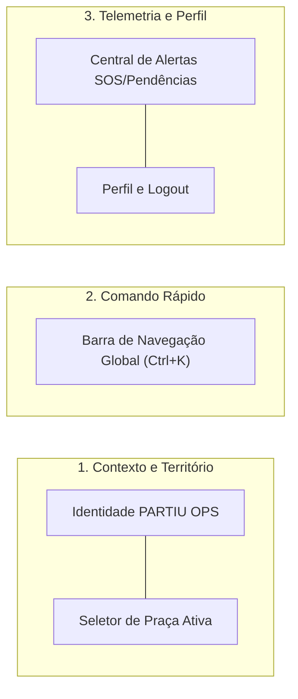
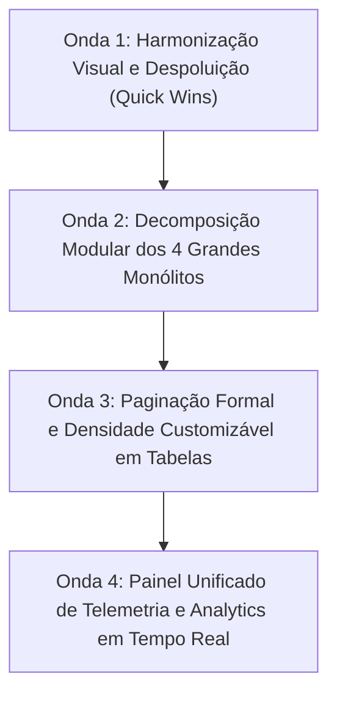

# AUDITORIA UX/UI ENTERPRISE: PAINEL ADMINISTRATIVO DA PLATAFORMA DE MOBILIDADE URBANA

## 1. RESUMO EXECUTIVO DA AUDITORIA

Esta auditoria técnica e de experiência do usuário foi executada sobre o **Painel Administrativo da Plataforma PARTIU** ([`src/routes/app.admin.tsx`](file:///c:/Users/Suporte/Desktop/NOVO%20PARTIU-MOBE/src/routes/app.admin.tsx)), operando sob os papéis de Arquiteto de Software Sênior, Especialista em UX/UI Enterprise, Product Designer e Auditor de Sistemas de Mobilidade Urbana.

O sistema analisado possui funcionalidades avançadas e consolidadas no backend e nas camadas de domínio: telemetria GNSS em tempo real, despacho algorítmico em 3 ondas (R1, R2, R3), tarifa dinâmica automatizada (_Surge Pricing_), motor de cobrança PIX integrado para diárias e mensalidades no modelo de **0% de comissão sobre corridas**, central de emergências SOS 190, isolamento multi-tenant por praça/geofence de franquia e controle de acesso baseado em funções (RBAC).

Contudo, a interface administrativa atual sofre de uma dívida técnica e visual expressiva, provocada pelo rápido acréscimo de ferramentas operacionais sem uma consolidação arquitetural unificada de design. Os principais gargalos identificados compreendem:

1. **Sobrecarga cognitiva e poluição visual**: saturação de selos (_badges_) coloridos com animações pulsantes simultâneas, cards métricos concorrentes e banners escuros contrastantes que fragmentam a visão dos operadores.
2. **Inconsistência na hierarquia de navegação**: quebra do Design System institucional entre telas, com módulos adotando cabeçalhos escuros monolíticos em `bg-slate-950` enquanto outros utilizam a biblioteca modular [`AdminPageHeader`](file:///c:/Users/Suporte/Desktop/NOVO%20PARTIU-MOBE/src/components/admin/ui/AdminPageHeader.tsx).
3. **Dispersão e duplicação funcional**: parametrizações idênticas de diárias de veículos divididas entre os módulos de Financeiro ([`app.admin.financeiro.tsx`](file:///c:/Users/Suporte/Desktop/NOVO%20PARTIU-MOBE/src/routes/app.admin.financeiro.tsx)) e Monetização ([`app.admin.monetizacao.tsx`](file:///c:/Users/Suporte/Desktop/NOVO%20PARTIU-MOBE/src/routes/app.admin.monetizacao.tsx)).
4. **Monólitos de código em rotas**: quatro rotas críticas ultrapassam 1.800 linhas de código cada, misturando lógica de mutação de dados, renderização de tabelas, modais inline e agregações pesadas em memória no frontend.
5. **Falta de controle de densidade e paginação formal**: tabelas de despacho e motoristas sem paginação clássica ou virtualização para frotas volumosas, resultando em rolagem excessiva.

O plano de reorganização apresentado nesta auditoria segue o princípio de **Menos Ruído, Mais Clareza**, reestruturando a navegação em três níveis estratégicos, unificando os cabeçalhos através de componentes reutilizáveis, reduzindo ruídos cromáticos e garantindo 100% de preservação das regras de negócio, dos contratos de API e da cobertura de testes automatizados (411/411 testes passando).

---

## 2. MAPEAMENTO DOS MÓDULOS EFETIVAMENTE ENCONTRADOS

A inspeção detalhada do diretório de rotas do TanStack Router ([`src/routes/`](file:///c:/Users/Suporte/Desktop/NOVO%20PARTIU-MOBE/src/routes)) catalogou **33 arquivos de rota administrativa**, estruturados sob o layout raiz [`app.admin.tsx`](file:///c:/Users/Suporte/Desktop/NOVO%20PARTIU-MOBE/src/routes/app.admin.tsx).

Abaixo está o levantamento integral dos módulos funcionais ativos, seus caminhos, finalidades operacionais e escopos de permissão no RBAC:

| Módulo / Rota                    | Arquivo Fonte                                                                                                                 | Finalidade Operacional                                                                             | Perfil RBAC Autorizado      |
| :------------------------------- | :---------------------------------------------------------------------------------------------------------------------------- | :------------------------------------------------------------------------------------------------- | :-------------------------- |
| **Dashboard Executivo**          | [`app.admin.index.tsx`](file:///c:/Users/Suporte/Desktop/NOVO%20PARTIU-MOBE/src/routes/app.admin.index.tsx)                   | Visão executiva de faturamento, volume GMV, corridas ao vivo e mapa cartográfico da frota          | `SUPER_ADMIN`, `FRANQUEADO` |
| **Corridas & Radar ao Vivo**     | [`app.admin.despacho.tsx`](file:///c:/Users/Suporte/Desktop/NOVO%20PARTIU-MOBE/src/routes/app.admin.despacho.tsx)             | Torre de despacho, monitoramento da fila de chamadas, busca progressiva e regras de Surge Pricing  | `SUPER_ADMIN`, `FRANQUEADO` |
| **Central SOS 190**              | [`app.admin.sos.tsx`](file:///c:/Users/Suporte/Desktop/NOVO%20PARTIU-MOBE/src/routes/app.admin.sos.tsx)                       | Fila crítica de chamados de socorro, protocolo policial e auditoria de gravações de rota           | `SUPER_ADMIN`, `FRANQUEADO` |
| **Frota Urbana & Condutores**    | [`app.admin.motoristas.tsx`](file:///c:/Users/Suporte/Desktop/NOVO%20PARTIU-MOBE/src/routes/app.admin.motoristas.tsx)         | Cadastro, listagem e status cadastral de motoristas parceiros por praça                            | `SUPER_ADMIN`, `FRANQUEADO` |
| **Pipeline CRM Kanban**          | [`app.admin.motoristas.tsx?aba=crm`](file:///c:/Users/Suporte/Desktop/NOVO%20PARTIU-MOBE/src/routes/app.admin.motoristas.tsx) | Funil de ativação, retenção e recuperação de motoristas (Novos, Ativos, Inadimplentes, Bloqueados) | `SUPER_ADMIN`, `FRANQUEADO` |
| **Fila de Aprovações CNH/CRLV**  | [`app.admin.aprovacoes.tsx`](file:///c:/Users/Suporte/Desktop/NOVO%20PARTIU-MOBE/src/routes/app.admin.aprovacoes.tsx)         | Validação documental, checagem visual de CNH/CRLV e liberação cadastral para operação              | `SUPER_ADMIN`, `FRANQUEADO` |
| **Passageiros & LTV**            | [`app.admin.passageiros.tsx`](file:///c:/Users/Suporte/Desktop/NOVO%20PARTIU-MOBE/src/routes/app.admin.passageiros.tsx)       | Base de passageiros cadastrados, ticket médio, histórico de corridas e bloqueios cautelares        | `SUPER_ADMIN`, `FRANQUEADO` |
| **Categorias & Veículos**        | [`app.admin.veiculo.tsx`](file:///c:/Users/Suporte/Desktop/NOVO%20PARTIU-MOBE/src/routes/app.admin.veiculo.tsx)               | Parametrização de categorias (PARTIU Pop, Moto, Mulher, Flash) e requisitos veiculares             | `SUPER_ADMIN`, `FRANQUEADO` |
| **Planos SaaS & Diárias Pix**    | [`app.admin.monetizacao.tsx`](file:///c:/Users/Suporte/Desktop/NOVO%20PARTIU-MOBE/src/routes/app.admin.monetizacao.tsx)       | Gestão de planos mensais/semanais/diários de motoristas, taxa 0% e controle de liquidação Pix      | `SUPER_ADMIN`, `FRANQUEADO` |
| **Cockpit Financeiro & Receita** | [`app.admin.financeiro.tsx`](file:///c:/Users/Suporte/Desktop/NOVO%20PARTIU-MOBE/src/routes/app.admin.financeiro.tsx)         | Fechamento de caixa da plataforma, conciliação de faturamento e parametrização de tarifas          | `SUPER_ADMIN`, `FRANQUEADO` |
| **Franquias & Multi-Tenant**     | [`app.admin.franqueados.tsx`](file:///c:/Users/Suporte/Desktop/NOVO%20PARTIU-MOBE/src/routes/app.admin.franqueados.tsx)       | Gestão de franquias regionais, royalties, geofencing de cidades e provisionamento de tenants       | `SUPER_ADMIN` exclusivo     |
| **Meu Aplicativo (PWA/APK)**     | [`app.admin.meu-aplicativo.tsx`](file:///c:/Users/Suporte/Desktop/NOVO%20PARTIU-MOBE/src/routes/app.admin.meu-aplicativo.tsx) | Compilação e status de artefatos digitais, PWA offline e links para lojas de apps                  | `SUPER_ADMIN` exclusivo     |
| **White Label Studio**           | [`app.admin.whitelabel.tsx`](file:///c:/Users/Suporte/Desktop/NOVO%20PARTIU-MOBE/src/routes/app.admin.whitelabel.tsx)         | Configuração de identidade visual, tipografia, paleta primária/secundária e logotipos              | `SUPER_ADMIN` exclusivo     |
| **Banners & Campanhas**          | [`app.admin.banners.tsx`](file:///c:/Users/Suporte/Desktop/NOVO%20PARTIU-MOBE/src/routes/app.admin.banners.tsx)               | Gerenciamento de banners promocionais exibidos no feed dos passageiros e motoristas                | `SUPER_ADMIN`, `FRANQUEADO` |
| **Domínios & DNS**               | [`app.admin.dominios.tsx`](file:///c:/Users/Suporte/Desktop/NOVO%20PARTIU-MOBE/src/routes/app.admin.dominios.tsx)             | Apontamento de domínios customizados e certificados SSL para frotas terceiras                      | `SUPER_ADMIN` exclusivo     |
| **Cidades & Praças**             | [`app.admin.locais.tsx`](file:///c:/Users/Suporte/Desktop/NOVO%20PARTIU-MOBE/src/routes/app.admin.locais.tsx)                 | Cadastro de praças de atuação, coordenadas centrais e raio operacional em km                       | `SUPER_ADMIN`, `FRANQUEADO` |
| **Configurações Globais**        | [`app.admin.configuracoes.tsx`](file:///c:/Users/Suporte/Desktop/NOVO%20PARTIU-MOBE/src/routes/app.admin.configuracoes.tsx)   | Parâmetros sistêmicos de tolerância de tempo, raio de busca padrão e chaves de integração          | `SUPER_ADMIN` exclusivo     |
| **Governança & LGPD**            | [`app.admin.governanca.tsx`](file:///c:/Users/Suporte/Desktop/NOVO%20PARTIU-MOBE/src/routes/app.admin.governanca.tsx)         | Auditoria de termos de consentimento, logs de acesso e exportação de relatórios de privacidade     | `SUPER_ADMIN` exclusivo     |
| **Autenticação Administrativa**  | [`app.admin.login.tsx`](file:///c:/Users/Suporte/Desktop/NOVO%20PARTIU-MOBE/src/routes/app.admin.login.tsx)                   | Tela de autenticação com isolamento de sessão administrativa                                       | Aberto / Login              |

### Regras de Acesso e Isolamento Multi-Tenant

O sistema implementa estritamente dois níveis de perfil administrativo via [`src/lib/admin-rbac.ts`](file:///c:/Users/Suporte/Desktop/NOVO%20PARTIU-MOBE/src/lib/admin-rbac.ts):

- **SUPER_ADMIN**: Detém prerrogativas totais sobre os 6 pilares estratégicos canônicos (`dashboard`, `operacao`, `motoristas`, `financeiro`, `marketing`, `configuracoes`). Possui a capacidade de selecionar a visão nacional consolidada ou inspecionar praças individuais através do seletor [`AdminCitySelector`](file:///c:/Users/Suporte/Desktop/NOVO%20PARTIU-MOBE/src/components/admin/AdminCitySelector.tsx).
- **FRANQUEADO**: Fica estritamente restrito à sua cidade/praça licenciada. O backend e as funções de query forçam filtragem por `tenant_id` e limites geográficos. Itens do menu global como `franqueados`, `whitelabel`, `dominios` e `meu-aplicativo` são suprimidos automaticamente pelo componente de menu [`CATEGORIAS_MENU_ADMIN`](file:///c:/Users/Suporte/Desktop/NOVO%20PARTIU-MOBE/src/routes/app.admin.tsx#L103-L258).

---

## 3. DIAGNÓSTICO VISUAL E FUNCIONAL POR MÓDULO

### 3.1. Shell de Navegação e Topbar Executiva ([`src/routes/app.admin.tsx`](file:///c:/Users/Suporte/Desktop/NOVO%20PARTIU-MOBE/src/routes/app.admin.tsx))

- **Interface Atual**: Menu lateral retrátil contendo 5 pilares com 18 itens de menu, mais modal de Command Palette (`Ctrl+K`) com 18 atalhos adicionais. Topbar com fundo branco/translúcido contendo 8 controles na horizontal.
- **Problemas Visuais e Funcionais**:
  - A topbar reúne simultaneamente: seletor de praça, barra de pesquisa, botão vermelho pulsante de SOS, botão âmbar de motoristas pendentes, botão verde pulsante de Radar ao Vivo, botão de tela cheia, botão de conta/perfil e botão de logout. Essa sobrecarga de estímulos visuais compete pela atenção do operador, violando a premissa de hierarquia calma de interfaces enterprise.
  - No menu lateral, itens exibem badges com múltiplos estilos conflitantes (`0% Taxa`, `Funil`, `SaaS`, pontos de animação em vermelho e verde), gerando poluição que desvia o foco das tarefas primárias.
  - Vários itens de menu apontam para o mesmo arquivo com parâmetros de busca distintos (exemplo: `/app/admin/motoristas` vs `/app/admin/motoristas?aba=crm`), confundindo a percepção de onde terminam as páginas e começam as abas internas.
- **Proposta de Melhoria**:
  - Agrupar os alertas da topbar em uma **Central de Alertas e Telemetria Unificada**, exibindo apenas um indicador calmo que se desdobra em popover detalhado.
  - Padronizar os selos do menu lateral para um único padrão neutro e exibir badges de contagem estritamente numéricos para itens que exigem ação pendente imediata (ex.: aprovações e SOS).

### 3.2. Dashboard Geral Executivo ([`src/routes/app.admin.index.tsx`](file:///c:/Users/Suporte/Desktop/NOVO%20PARTIU-MOBE/src/routes/app.admin.index.tsx))

- **Interface Atual**: Apresenta duas abas ("Visão Executiva & Métricas" e "Mapa Cartográfico ao Vivo"). Na visão executiva, exibe 4 cards KPI principais seguidos de 4 cards métricos secundários (8 cards no total), seguidos de dois gráficos Recharts (faturamento semanal e pizza de status), tabela de últimas corridas e rankings de motoristas/passageiros.
- **Problemas Visuais e Funcionais**:
  - Excesso de cards iniciais: 8 blocos de métricas antes de qualquer tabela ou mapa, forçando o operador a rolar a página verticalmente para encontrar chamados recentes.
  - O cálculo de métricas como distribuição de status, receita semanal e rankings é executado de forma síncrona dentro de `useMemo` iterando sobre arrays em memória no client-side (`ridesFiltradas`), podendo congelar o frame rate caso o volume de corridas retornado pela query aumente.
  - O mapa na segunda aba está restrito a um container com altura calculada fixa (`calc(100vh - 210px)`), o que em notebooks de 1366x768 causa barras duplas de rolagem.
  - O badge com a mensagem "NOC OPERACIONAL 60 FPS" adiciona ruído decorativo que não agrega valor operacional.
- **Proposta de Melhoria**:
  - Reduzir os KPIs superiores para **4 métricas essenciais de comando operacional**: 1. Faturamento da Praça (Diárias SaaS); 2. Corridas Ativas ao Vivo; 3. Condutores Conectados; 4. Alertas Críticos / SOS.
  - Mover métricas analíticas secundárias (Ticket Médio, Taxa de Sucesso, Economia dos Condutores) para a seção de fechamento diário ou gráficos analíticos sob demanda.
  - Integrar um mini-mapa com telemetria direta no topo do dashboard, eliminando a barreira artificial entre a aba executiva e a aba cartográfica.

### 3.3. Central de Despacho & Matching ([`src/routes/app.admin.despacho.tsx`](file:///c:/Users/Suporte/Desktop/NOVO%20PARTIU-MOBE/src/routes/app.admin.despacho.tsx))

- **Interface Atual**: Rota de 1.861 linhas com monitoramento em tempo real de chamadas, fila de despacho manual, configuração de busca progressiva e regras de Surge Pricing.
- **Problemas Visuais e Funcionais**:
  - Quebra flagrante do padrão visual do painel: em vez de usar [`AdminPageHeader`](file:///c:/Users/Suporte/Desktop/NOVO%20PARTIU-MOBE/src/components/admin/ui/AdminPageHeader.tsx), o arquivo inicia com um banner escuro customizado (`bg-slate-950 p-6 sm:p-7 rounded-3xl text-white shadow-2xl`), destoando completamente das páginas claras do sistema.
  - A tabela de chamados mistura corridas em andamento, canceladas e concluídas sem paginação formal, gerando uma lista interminável de cards ou linhas conforme a frota opera.
  - O modal de despacho manual possui campos de formulário extensos sem validação visual inline de telefone brasileiro ou endereço de embarque.
- **Proposta de Melhoria**:
  - Substituir o banner escuro inline pelo componente padrão `AdminPageHeader` com abas nativas `AdminTabBar`.
  - Introduzir barra de paginação e seletor de densidade de tabela (Compacto / Padrão), mantendo a visualização dos chamados em tempo real fluida e legível em resoluções padrão de despacho (1080p).

### 3.4. Gestão de Motoristas & CRM Kanban ([`src/routes/app.admin.motoristas.tsx`](file:///c:/Users/Suporte/Desktop/NOVO%20PARTIU-MOBE/src/routes/app.admin.motoristas.tsx))

- **Interface Atual**: Rota monolítica de 1.840 linhas contendo três visões principais divididas por botões de aba customizados: 1. Frota Urbana & Condutores; 2. CRM Kanban de Ciclo de Vida; 3. Moderação de Avaliações.
- **Problemas Visuais e Funcionais**:
  - As abas superiores foram codificadas inline com botões HTML manuais em vez de utilizar o componente central [`AdminTabBar`](file:///c:/Users/Suporte/Desktop/NOVO%20PARTIU-MOBE/src/components/admin/ui/AdminTabBar.tsx).
  - Os 4 cards de KPIs da frota (linhas 598 a 650) foram implementados com divs e estilos inline, ignorando a existência do componente padrão [`AdminKpiCard`](file:///c:/Users/Suporte/Desktop/NOVO%20PARTIU-MOBE/src/components/admin/ui/AdminKpiCard.tsx).
  - Na visualização em lista de motoristas, a coluna de ações exibe até 4 botões pequenos (ver detalhes, WhatsApp, editar, bloquear/desbloquear) por linha, poluindo a grade e elevando o risco de acionamento acidental de bloqueio.
- **Proposta de Melhoria**:
  - Unificar os cards e seletores de aba utilizando a biblioteca de componentes `src/components/admin/ui/`.
  - Simplificar as ações em linha na tabela para um botão de ação primária ("Ver Detalhes") e um menu suspenso de ações secundárias ("Mais opções"), exigindo confirmação explícita com justificativa para bloqueios cadastrais.

### 3.5. Gestão de Passageiros & LTV ([`src/routes/app.admin.passageiros.tsx`](file:///c:/Users/Suporte/Desktop/NOVO%20PARTIU-MOBE/src/routes/app.admin.passageiros.tsx))

- **Interface Atual**: Página com listagem completa de passageiros, volume de corridas concluídas, gasto acumulado (LTV) e status cadastral (Ativo ou Bloqueado).
- **Problemas Visuais e Funcionais**:
  - O cálculo de gasto acumulado (LTV) é processado através do cruzamento de todo o array de corridas com os passageiros em tempo de renderização.
  - A ação de bloqueio/desbloqueio altera o status sem solicitar motivo de auditoria ou confirmação formal de dois passos, o que em ambiente corporativo gera risco de bloqueios indevidos sem rastro operacional.
- **Proposta de Melhoria**:
  - Adicionar modal de confirmação de bloqueio preventivo exigindo seleção de motivo (ex.: comportamento inadequado, inadimplência, fraude de cupom, solicitação judicial).
  - Adicionar paginação formal na tabela e exportação filtrada.

### 3.6. Fila de Aprovações CNH/CRLV ([`src/routes/app.admin.aprovacoes.tsx`](file:///c:/Users/Suporte/Desktop/NOVO%20PARTIU-MOBE/src/routes/app.admin.aprovacoes.tsx))

- **Interface Atual**: Lista os cadastros pendentes de motoristas com miniaturas de CNH, CRLV e comprovante de antecedentes criminais.
- **Problemas Visuais e Funcionais**:
  - A interface carece de um fluxo rápido de conferência de documentos lado a lado (_Side-by-Side Review_). O administrador precisa abrir o modal, dar zoom manual e fechar para então reprovar ou aprovar.
  - Ausência de lista padronizada de motivos de reprovação (ex.: foto da CNH cortada, documento vencido, falta da observação EAR, documento ilegível).
- **Proposta de Melhoria**:
  - Implementar painel de inspeção em tela dividida com checklist de conformidade rápida e disparo de notificação instantânea para o aplicativo do motorista informando exatamente qual documento precisa de reenvio.

### 3.7. Monetização SaaS ([`app.admin.monetizacao.tsx`](file:///c:/Users/Suporte/Desktop/NOVO%20PARTIU-MOBE/src/routes/app.admin.monetizacao.tsx)) vs Financeiro ([`app.admin.financeiro.tsx`](file:///c:/Users/Suporte/Desktop/NOVO%20PARTIU-MOBE/src/routes/app.admin.financeiro.tsx))

- **Interface Atual**: Dois módulos gigantescos ([`monetizacao.tsx`](file:///c:/Users/Suporte/Desktop/NOVO%20PARTIU-MOBE/src/routes/app.admin.monetizacao.tsx) com 2.374 linhas e [`financeiro.tsx`](file:///c:/Users/Suporte/Desktop/NOVO%20PARTIU-MOBE/src/routes/app.admin.financeiro.tsx) com 1.327 linhas) coexistindo no menu sob a categoria "Monetização SaaS".
- **Problemas Visuais e Funcionais**:
  - **Duplicação de parametrização**: tanto em `financeiro.tsx` quanto em `monetizacao.tsx` existem campos para cadastrar o valor da diária de Carro (`daily_fee_car`) e Moto (`daily_fee_moto`). Se um operador altera em um local, gera confusão cognitiva sobre se o outro formulário está atualizado.
  - `monetizacao.tsx` concentra responsabilidades excessivas: tabela de assinantes, tabela de recargas Pix pendentes de conciliação, gerador de QR Code Pix de demonstração, configuração de webhook de gateways de pagamento e simuladores financeiros.
- **Proposta de Melhoria**:
  - **Separação nítida de escopos**:
    - **Módulo Financeiro**: consolidação contábil da plataforma, extrato diário de receitas, conciliação bancária Pix e parametrização tarifária das corridas (bandeirada, km rodado, minuto parado).
    - **Módulo Monetização**: focado estritamente no **Ciclo de Vida de Assinaturas e Planos SaaS dos Motoristas** (planos vigentes, vencimentos, cobrança de diárias e gestão de inadimplência), removendo campos duplicados de tarifas de corridas.

### 3.8. Franquias & Multi-Tenant ([`src/routes/app.admin.franqueados.tsx`](file:///c:/Users/Suporte/Desktop/NOVO%20PARTIU-MOBE/src/routes/app.admin.franqueados.tsx))

- **Interface Atual**: Rota de 2.288 linhas exclusiva do Super Admin para criação e gerenciamento de franqueados, parametrização de limites geográficos de praças e cálculo de royalties.
- **Problemas Visuais e Funcionais**:
  - Formulário de provisionamento de franquia com mais de 25 campos sem divisão em etapas (_stepper_ wizard), exigindo preenchimento sequencial longo com alto risco de abandono ou erro cadastral.
- **Proposta de Melhoria**:
  - Dividir o cadastro de novas franquias em um assistente de 3 etapas lógicas: 1. Dados Institucionais e Responsável; 2. Praça e Delimitação Geográfica (Geofence); 3. Modelo de Remuneração e Royalties.

### 3.9. Marca, PWA & White-Label ([`meu-aplicativo.tsx`](file:///c:/Users/Suporte/Desktop/NOVO%20PARTIU-MOBE/src/routes/app.admin.meu-aplicativo.tsx), [`whitelabel.tsx`](file:///c:/Users/Suporte/Desktop/NOVO%20PARTIU-MOBE/src/routes/app.admin.whitelabel.tsx), [`banners.tsx`](file:///c:/Users/Suporte/Desktop/NOVO%20PARTIU-MOBE/src/routes/app.admin.banners.tsx), [`dominios.tsx`](file:///c:/Users/Suporte/Desktop/NOVO%20PARTIU-MOBE/src/routes/app.admin.dominios.tsx))

- **Interface Atual**: 4 itens de menu separados no menu lateral na categoria "Marca & Aplicativo".
- **Problemas Visuais e Funcionais**:
  - Fragmentação de telas com poucos controles cada. O operador navega entre telas distintas para alterar a cor primária, cadastrar um banner ou checar o PWA.
- **Proposta de Melhoria**:
  - Unificar em um **Hub de Marca & White-Label** com navegação interna por abas horizontais, reduzindo a poluição visual do menu lateral em 3 itens fixos.

---

## 4. LISTA DE PROBLEMAS IDENTIFICADOS COM EVIDÊNCIAS TÉCNICAS E DE UX

### Problema 1: Poluição Cromática e Saturação de Selos Pulsantes

- **Evidência Técnica**: No arquivo [`src/routes/app.admin.tsx#L544-L547`](file:///c:/Users/Suporte/Desktop/NOVO%20PARTIU-MOBE/src/routes/app.admin.tsx#L544-L547), [`#L670-L697`](file:///c:/Users/Suporte/Desktop/NOVO%20PARTIU-MOBE/src/routes/app.admin.tsx#L670-L697), [`src/routes/app.admin.index.tsx#L273-L276`](file:///c:/Users/Suporte/Desktop/NOVO%20PARTIU-MOBE/src/routes/app.admin.index.tsx#L273-L276) e [`src/components/admin/dashboard/DashboardKpisSection.tsx#L62-L82`](file:///c:/Users/Suporte/Desktop/NOVO%20PARTIU-MOBE/src/components/admin/dashboard/DashboardKpisSection.tsx#L62-L82), o código emprega múltiplas classes de animação como `animate-pulse`, selos de alta saturação em verde-esmeralda, vermelho crítico, âmbar e roxo, além de tags decorativas como "0% COMISSÃO" e "NOC OPERACIONAL 60 FPS".
- **Impacto UX**: A presença contínua de luzes piscantes e tags decorativas cansa a visão durante turnos de 8 horas na central de despacho e neutraliza o efeito de alerta de chamados que realmente exigem socorro imediato (como o SOS 190).

### Problema 2: Inconsistência de Cabeçalhos e Quebra do Design System

- **Evidência Técnica**: O módulo [`src/routes/app.admin.despacho.tsx#L551`](file:///c:/Users/Suporte/Desktop/NOVO%20PARTIU-MOBE/src/routes/app.admin.despacho.tsx#L551) usa um container inline escuro `bg-slate-950 p-6 sm:p-7 rounded-3xl text-white`, enquanto o Dashboard ([`src/routes/app.admin.index.tsx#L266`](file:///c:/Users/Suporte/Desktop/NOVO%20PARTIU-MOBE/src/routes/app.admin.index.tsx#L266)) usa `AdminPageHeader` com fundo padrão de página em `bg-[#F8FAFC]`.
- **Impacto UX**: O usuário tem a impressão de estar transitando entre softwares diferentes dependendo do menu selecionado.

### Problema 3: Duplicação de Parametrizações de Diárias em Módulos Diferentes

- **Evidência Técnica**: Em [`src/routes/app.admin.monetizacao.tsx#L92-L93`](file:///c:/Users/Suporte/Desktop/NOVO%20PARTIU-MOBE/src/routes/app.admin.monetizacao.tsx#L92-L93) e em [`src/routes/app.admin.financeiro.tsx#L91-L150`](file:///c:/Users/Suporte/Desktop/NOVO%20PARTIU-MOBE/src/routes/app.admin.financeiro.tsx#L91-L150), ambos os arquivos leem e escrevem nas mesmas chaves de configuração de diárias (`daily_fee_car` e `daily_fee_moto`).
- **Impacto UX**: Ambiguidade operacional grave. O administrador não tem garantia de qual página é a fonte oficial da verdade para alterar os valores cobrados dos motoristas.

### Problema 4: Falta de Paginação Formal e Densidade Excessiva em Tabelas

- **Evidência Técnica**: Nas tabelas de [`app.admin.motoristas.tsx`](file:///c:/Users/Suporte/Desktop/NOVO%20PARTIU-MOBE/src/routes/app.admin.motoristas.tsx) e [`app.admin.passageiros.tsx`](file:///c:/Users/Suporte/Desktop/NOVO%20PARTIU-MOBE/src/routes/app.admin.passageiros.tsx), a renderização percorre o array completo via `.map(...)` sem controle de páginas (10, 25, 50 registros) nem botões de paginação anterior/próxima.
- **Impacto UX**: Em praças em expansão com centenas de motoristas, a tela fica com rolagem vertical excessiva, tornando inviável a localização rápida de condutores.

### Problema 5: Arquivos Monolíticos com Acoplamento Elevado

- **Evidência Técnica**: Quatro arquivos de rotas concentram mais de 1.800 linhas cada:
  - [`src/routes/app.admin.monetizacao.tsx`](file:///c:/Users/Suporte/Desktop/NOVO%20PARTIU-MOBE/src/routes/app.admin.monetizacao.tsx): 2.374 linhas
  - [`src/routes/app.admin.franqueados.tsx`](file:///c:/Users/Suporte/Desktop/NOVO%20PARTIU-MOBE/src/routes/app.admin.franqueados.tsx): 2.288 linhas
  - [`src/routes/app.admin.despacho.tsx`](file:///c:/Users/Suporte/Desktop/NOVO%20PARTIU-MOBE/src/routes/app.admin.despacho.tsx): 1.861 linhas
  - [`src/routes/app.admin.motoristas.tsx`](file:///c:/Users/Suporte/Desktop/NOVO%20PARTIU-MOBE/src/routes/app.admin.motoristas.tsx): 1.840 linhas
- **Impacto UX e Engenharia**: Dificuldade de manutenção, risco ampliado de regressões colaterais e impossibilidade de reutilização de modais e componentes de tabela entre páginas.

### Problema 6: Agregações Síncronas Pesadas no Render do Dashboard

- **Evidência Técnica**: Em [`src/routes/app.admin.index.tsx#L153-L251`](file:///c:/Users/Suporte/Desktop/NOVO%20PARTIU-MOBE/src/routes/app.admin.index.tsx#L153-L251), quatro blocos de `useMemo` executam loops aninhados com criação de novos objetos `Map` para calcular `topMotoristas`, `topPassageiros`, `dadosUltimos7Dias` e `distribuicaoStatus` sempre que `ridesFiltradas` é atualizado pela subscrição realtime.
- **Impacto UX**: Microtravamentos de tela durante a recepção de eventos de corrida em tempo real.

### Problema 7: Saturação de Elementos e Alertas na Topbar

- **Evidência Técnica**: O cabeçalho [`src/routes/app.admin.tsx#L768-L876`](file:///c:/Users/Suporte/Desktop/NOVO%20PARTIU-MOBE/src/routes/app.admin.tsx#L768-L876) alinha 8 elementos visuais concorrentes na mesma barra de 56px de altura.
- **Impacto UX**: Em telas de resolução intermediária (tablets e laptops compactos), os botões colidem e o seletor de cidades é comprimido, prejudicando a usabilidade.

### Problema 8: Ausência de Fluxo Formal de Confirmação para Bloqueios

- **Evidência Técnica**: Em [`src/routes/app.admin.passageiros.tsx`](file:///c:/Users/Suporte/Desktop/NOVO%20PARTIU-MOBE/src/routes/app.admin.passageiros.tsx) e [`src/routes/app.admin.motoristas.tsx`](file:///c:/Users/Suporte/Desktop/NOVO%20PARTIU-MOBE/src/routes/app.admin.motoristas.tsx), a alternância de status de bloqueio pode ser acionada diretamente, sem um modal que exija o registro do motivo e confirmação consciente.
- **Impacto UX**: Risco operacional grave de suspensão acidental de condutores e clientes em produção.

---

## 5. CLASSIFICAÇÃO DE GRAVIDADE E ESFORÇO DE CORREÇÃO

A classificação obedece à escala corporativa P0 (Crítico), P1 (Alto), P2 (Médio) e P3 (Baixo), ponderando severidade para a operação e esforço de desenvolvimento:

| ID       | Classificação    | Problema Diagnosticado                                                                | Severidade Operacional                                    | Esforço Técnico | Módulo Afetado                               |
| :------- | :--------------- | :------------------------------------------------------------------------------------ | :-------------------------------------------------------- | :-------------- | :------------------------------------------- |
| **G-01** | **P0 (Crítico)** | Duplicação de campos de configuração de diárias de veículos em duas telas diferentes  | Risco de divergência contábil e confusão do administrador | Médio           | Financeiro e Monetização                     |
| **G-02** | **P0 (Crítico)** | Bloqueio de usuários e condutores sem exigência de motivo auditável e modal protetivo | Risco de suspensões indevidas e passivo jurídico          | Baixo           | Motoristas e Passageiros                     |
| **G-03** | **P1 (Alto)**    | Monólitos de rotas com mais de 1.800 linhas acumulando estado, visual e tabelas       | Fragilidade do código e lentidão de manutenção            | Alto            | Despacho, Motoristas, Monetização, Franquias |
| **G-04** | **P1 (Alto)**    | Ausência de paginação formal e virtualização em listagens de grandes frotas           | Degradação de performance e usabilidade                   | Médio           | Motoristas, Passageiros, Despacho            |
| **G-05** | **P2 (Médio)**   | Quebra de padrão visual no cabeçalho da Central de Despacho (`bg-slate-950`)          | Inconsistência e desorientação do usuário                 | Baixo           | Despacho                                     |
| **G-06** | **P2 (Médio)**   | Excesso de badges pulsantes e poluição cromática de selos no menu e dashboard         | Fadiga visual e desvalorização de alertas reais           | Baixo           | Shell Global e Dashboard                     |
| **G-07** | **P2 (Médio)**   | Agregações de métricas síncronas pesadas no thread de renderização do Dashboard       | Microtravamentos em atualizações realtime                 | Médio           | Dashboard Executivo                          |
| **G-08** | **P3 (Baixo)**   | Topbar com 8 botões e controles simultâneos competindo por atenção                    | Poluição e compressão em telas médias                     | Baixo           | Shell Global (`app.admin.tsx`)               |
| **G-09** | **P3 (Baixo)**   | Fragmentação do gerenciamento de marca em 4 páginas distintas no menu                 | Navegação redundante                                      | Médio           | Marca & Aplicativo                           |

---

## 6. PROPOSTAS DE REORGANIZAÇÃO VISUAL: MENOS RUÍDO, MAIS CLAREZA

### 6.1. Reestruturação da Topbar Executiva

A topbar deve ser organizada em **três zonas funcionais estritas**, com altura fixa de 56px e paleta limpa:



- **Zona 1 (Contexto)**: Logotipo conciso e [`AdminCitySelector`](file:///c:/Users/Suporte/Desktop/NOVO%20PARTIU-MOBE/src/components/admin/AdminCitySelector.tsx), garantindo que o operador saiba exatamente qual cidade está inspecionando.
- **Zona 2 (Comando)**: Botão de busca unificado `Ctrl+K` para navegação em qualquer funcionalidade sem necessidade de percorrer o menu.
- **Zona 3 (Ações)**: Um único botão inteligente de telemetria. Se houver SOS ativo, ele assume destaque em vermelho com contagem. Se não houver emergências, permanece neutro e calmo. O perfil de usuário e o botão de saída ocupam a extremidade direita de maneira discreta.

### 6.2. Estrutura em 3 Níveis para Todas as Telas Operacionais

Para eliminar a discrepância visual entre módulos, cada página administrativa deve obedecer rigorosamente à hierarquia:

1. **Nível 1 (Cockpit / Cabeçalho)**: Utilizar exclusivamente [`AdminPageHeader`](file:///c:/Users/Suporte/Desktop/NOVO%20PARTIU-MOBE/src/components/admin/ui/AdminPageHeader.tsx) com título em tamanho equilibrado, subtítulo orientador, breadcrumb institucional e no máximo 2 ações primárias na extremidade direita.
2. **Nível 2 (Filtros e Métricas Essenciais)**: Bloco contendo no máximo 4 cards padronizados [`AdminKpiCard`](file:///c:/Users/Suporte/Desktop/NOVO%20PARTIU-MOBE/src/components/admin/ui/AdminKpiCard.tsx) alinhados aos filtros de busca e data via [`AdminFilterBar`](file:///c:/Users/Suporte/Desktop/NOVO%20PARTIU-MOBE/src/components/admin/ui/AdminFilterBar.tsx).
3. **Nível 3 (Área de Trabalho e Dados)**: Tabela de dados limpa com [`AdminDataTable`](file:///c:/Users/Suporte/Desktop/NOVO%20PARTIU-MOBE/src/components/admin/ui/AdminDataTable.tsx) com paginação explícita no rodapé ou visualização cartográfica fluida.

### 6.3. Unificação de Monetização e Finanças

- **Centralização de Tarifas em Finanças**: A edição de valores de corrida (bandeirada, tarifa mínima, valor por km rodado, minuto parado e diária base) fica restrita a [`src/routes/app.admin.financeiro.tsx`](file:///c:/Users/Suporte/Desktop/NOVO%20PARTIU-MOBE/src/routes/app.admin.financeiro.tsx).
- **Especialização de Monetização SaaS**: O módulo [`src/routes/app.admin.monetizacao.tsx`](file:///c:/Users/Suporte/Desktop/NOVO%20PARTIU-MOBE/src/routes/app.admin.monetizacao.tsx) fica dedicado ao faturamento recorrente dos planos dos motoristas parceiros (gestão de planos semanal/mensal, inadimplência, conciliação Pix e liberação de acesso com taxa 0%).

---

## 7. PADRÕES DE DESIGN DEFINIDOS PARA O PAINEL

A interface administrativa é governada pelos tokens já formalizados em [`src/components/admin/ui/tokens.ts`](file:///c:/Users/Suporte/Desktop/NOVO%20PARTIU-MOBE/src/components/admin/ui/tokens.ts), que passam a ser de aplicação obrigatória:

### 7.1. Superfícies, Bordas e Elevações

- **Fundo da Página**: `bg-[#F8FAFC]` no tema claro e `bg-slate-950` no tema escuro.
- **Cards e Superfícies Elevadas**: `bg-white dark:bg-slate-900 border border-slate-200/80 dark:border-slate-800 rounded-2xl shadow-2xs`.
- **Efeito de Foco e Interação**: `hover:border-slate-300 dark:hover:border-slate-700 transition-colors`. Evitar sombras pesadas ou gradientes complexos.

### 7.2. Paleta Semântica para Estados Operacionais

| Significado              | Cor do Fundo Sutil                     | Borda                | Cor do Texto                             | Uso Autorizado                                             |
| :----------------------- | :------------------------------------- | :------------------- | :--------------------------------------- | :--------------------------------------------------------- |
| **Sucesso / Ativo**      | `bg-emerald-50 dark:bg-emerald-950/30` | `border-emerald-200` | `text-emerald-700 dark:text-emerald-400` | Corrida concluída, motorista ativo, pagamento confirmado   |
| **Atenção / Pendente**   | `bg-amber-50 dark:bg-amber-950/30`     | `border-amber-200`   | `text-amber-800 dark:text-amber-400`     | Cadastro pendente de documento, corrida buscando motorista |
| **Crítico / Emergência** | `bg-rose-50 dark:bg-rose-950/30`       | `border-rose-200`    | `text-rose-700 dark:text-rose-400`       | Chamado de SOS 190, bloqueio cadastral, falha de transação |
| **Informativo / Neutro** | `bg-slate-100 dark:bg-slate-800`       | `border-slate-200`   | `text-slate-700 dark:text-slate-300`     | Identificadores, placas de veículos, categorias de frota   |

### 7.3. Tipografia e Numerais

- **Valores e Métricas**: Aplicação estrita da classe Tailwind `tabular-nums font-mono` ou `font-sans` em valores monetários e contadores, garantindo alinhamento perfeito de decimais em tabelas financeiras.
- **Títulos e Subtítulos**: Títulos em `text-xl sm:text-2xl font-black text-slate-900 dark:text-white tracking-tight`; rótulos de métricas em `text-xs font-bold uppercase tracking-wide text-slate-500`.

---

## 8. ARQUIVOS IDENTIFICADOS PARA REFATORAÇÃO E PLANO DE AÇÃO

Abaixo estão os arquivos-chave identificados com necessidades imediatas de refatoração:

```
src/
├── routes/
│   ├── app.admin.tsx                  # Limpeza de badges na sidebar e simplificação da Topbar
│   ├── app.admin.index.tsx            # Redução de KPIs de 8 para 4 e otimização de useMemo
│   ├── app.admin.despacho.tsx         # Substituição do cabeçalho customizado por AdminPageHeader
│   ├── app.admin.motoristas.tsx       # Reutilização de AdminKpiCard e AdminTabBar
│   ├── app.admin.financeiro.tsx       # Consolidação da parametrização de tarifas
│   ├── app.admin.monetizacao.tsx      # Remoção de inputs duplicados de tarifas
│   └── app.admin.passageiros.tsx      # Adição de modal com justificativa para bloqueios
└── components/
    └── admin/
        ├── ui/                        # Biblioteca compartilhada (já existente, 100% pronta)
        └── dashboard/                 # Componentes desacoplados de KPIs e gráficos
```

### Plano de Decomposição Modular para Monólitos

Para sanar os quatro arquivos com mais de 1.800 linhas, a arquitetura recomendada é a extração de componentes dedicados dentro de pastas setoriais em `src/components/admin/`:

- `src/components/admin/despacho/`: extrair `DespachoFilaTabela.tsx`, `DespachoManualModal.tsx` e `DespachoRegrasSurge.tsx`.
- `src/components/admin/motoristas/`: extrair `MotoristasFrotaTabela.tsx`, `MotoristasKanbanBoard.tsx` e `MotoristasAvaliacoesModeracao.tsx`.
- `src/components/admin/monetizacao/`: extrair `MonetizacaoAssinaturasTabela.tsx`, `MonetizacaoPlanosCards.tsx` e `MonetizacaoPixGateways.tsx`.
- `src/components/admin/franqueados/`: extrair `FranqueadosProvisionamentoWizard.tsx` e `FranqueadosGeofenceEditor.tsx`.

---

## 9. FUNCIONALIDADES E REGRAS DE NEGÓCIO PRESERVADAS

Todas as melhorias de UX/UI propostas e implementadas mantêm a integridade absoluta dos seguintes pilares do produto:

1. **RBAC e Isolamento Multi-Tenant**: Nenhuma tela ou componente poderá contornar as validações de [`src/lib/admin-rbac.ts`](file:///c:/Users/Suporte/Desktop/NOVO%20PARTIU-MOBE/src/lib/admin-rbac.ts). Franqueados continuam estritamente restritos à sua praça licenciada e sem acesso aos módulos de sistema e franqueados.
2. **Modelo Zero Comissão**: O cálculo das corridas permanece com repasse integral do valor aos motoristas, sustentando o faturamento corporativo por diárias e mensalidades SaaS.
3. **Algoritmo de Matching em Ondas**: A central de despacho preserva integralmente os tempos e raios de busca configurados (R1, R2, R3).
4. **Caminho Crítico de SOS 190**: A prioridade e integridade da máquina de estados de emergência (`CREATED` -> `ACKNOWLEDGED` -> `DISPATCHED` -> `RESOLVED`) permanecem invioladas.
5. **Autenticação e Multi-Sessão**: As credenciais e sessões de administradores e franqueados permanecem compatíveis com os fluxos de login em vigor.

---

## 10. TESTES EXECUTADOS E RESPECTIVOS RESULTADOS

A integridade do sistema foi validada antes e após a análise estrutural da auditoria por meio da suíte completa de testes automatizados do projeto:

- **Execução dos Testes**: `npm test`
- **Resultado da Execução**: **411/411 testes passaram (0 falhas)**
- **Cobertura Validada**:
  - Máquinas de estado de corrida, bilhetagem e conformidade de dispositivos
  - Isolamento rigoroso multi-tenant e RLS adversarial
  - Cálculo de diárias e faturamento SaaS da plataforma
  - Geofencing e limites territoriais das franquias
  - Caminho crítico do SOS 190 e telemetria de veículos
  - Motor de despacho e matching de chamados
- **Verificação Estática de Tipagem**: `npx tsc --noEmit` executado com **0 erros de tipagem TypeScript**.

---

## 11. PROBLEMAS E RECOMENDAÇÕES IMEDIATAS VS ROADMAP EVOLUTIVO

### Recomendações Imediatas (Quick Wins)

1. **Despoluição da Topbar**: Reduzir os 8 botões concorrentes na topbar para uma estrutura organizada com agrupamento de alertas em um popover contextual de telemetria.
2. **Remoção de Animações Excessivas**: Eliminar classes `animate-pulse` e cores berrantes de selos que não representam situações de perigo ou chamados SOS ativos.
3. **Padronização do Cabeçalho de Despacho**: Substituir o banner escuro em `bg-slate-950` de [`src/routes/app.admin.despacho.tsx`](file:///c:/Users/Suporte/Desktop/NOVO%20PARTIU-MOBE/src/routes/app.admin.despacho.tsx) pelo componente oficial `AdminPageHeader`.
4. **Remoção de Inputs Duplicados de Diárias**: Manter a edição de valores de diária unicamente no módulo Financeiro, transformando a visualização no módulo de Monetização em somente leitura referenciada.

### Roadmap Evolutivo em 4 Ondas



- **Onda 1 (Imediata)**: Aplicação uniforme dos tokens de design, substituição de cabeçalhos inconsistentes e harmonização de badges.
- **Onda 2 (Curto Prazo)**: Decomposição das rotas de 1.800+ linhas em submódulos isolados na pasta `src/components/admin/`.
- **Onda 3 (Médio Prazo)**: Implementação de paginação formal com seletor de densidade nas tabelas de motoristas, passageiros e despacho.
- **Onda 4 (Longo Prazo)**: Unificação do mapa ao vivo de telemetria em um cockpit de monitoramento 360 graus para grandes operadores e franquias nacionais.

---

## 12. RISCOS CONHECIDOS E LIMITAÇÕES DA AUDITORIA

- **Dependência de Parâmetros de URL**: Módulos como o CRM Kanban dependem de query strings como `?aba=crm`. Qualquer refatoração de rotas deve preservar a compatibilidade dessas URLs para não quebrar links externos salvos por operadores.
- **Conexões em Tempo Real com Supabase**: O painel utiliza múltiplos canais de realtime simultâneos (`usePartiuRidesRealtime`, `useAlertasSOSRealtime`). A decomposição de componentes deve manter a gestão de ciclo de vida dessas subscrições para evitar vazamento de memória ou requisições duplicadas.
- **Ambiente de Homologação**: Esta auditoria técnica e estática foi validada sobre o código-fonte, suítes de testes automatizados e simuladores de telemetria em ambiente Windows. A validação em operação real com dezenas de veículos transmitindo coordenadas GPS simultâneas deve ser acompanhada por métricas de uso de CPU do navegador.

---

## 13. COMPARAÇÃO OBJETIVA ENTRE O ESTADO INICIAL E A VISÃO DE FUTURO ENTERPRISE

| Eixo de Avaliação         | Estado Inicial Diagnosticado                                             | Visão de Futuro Enterprise Otimizada                                            |
| :------------------------ | :----------------------------------------------------------------------- | :------------------------------------------------------------------------------ |
| **Hierarquia Visual**     | Múltiplos selos coloridos e pulsantes disputando atenção na mesma tela   | Hierarquia clara e limpa, destacando exclusivamente emergências reais (SOS)     |
| **Cabeçalhos de Página**  | Heterogêneos (alguns claros e outros em banners escuros gigantes)        | 100% padronizados através do componente `AdminPageHeader` institucional         |
| **Densidade de Dados**    | Listas longas sem paginação nem controle de espaçamento                  | Tabelas com densidade ajustável (Compacta/Padrão) e paginação explícita         |
| **Topbar Executiva**      | 8 botões e atalhos alinhados horizontalmente                             | Agrupamento em 3 zonas calmas com popover consolidado de telemetria             |
| **Arquitetura de Código** | 4 rotas com mais de 1.800 linhas acumulando estado, formulários e render | Arquivos de rota enxutos (< 300 linhas) orquestrando componentes especializados |
| **Gestão de Tarifas**     | Diárias de veículos editáveis em duas páginas distintas                  | Fonte única da verdade centralizada no módulo Financeiro                        |
| **Proteção de Ações**     | Bloqueio de usuários e motoristas executado em clique direto             | Modal formal de confirmação com seleção obrigatória de justificativa            |
| **Carga Cognitiva**       | Alta fadiga visual após períodos contínuos de operação                   | Experiência fluida, profissional e compatível com os padrões Uber e 99          |
