# User Flows

<!-- Managed with super-ux (ux-contract v4). The HOW layer: task analysis
and user flows. Flows reference screens by SCR-ID (full specs live in
screens.md). Scenarios in scenarios.md trace to FLW-IDs and must cover every
node and edge. -->

### FLW-01: Solicitação e Embarque da Corrida

- **Traces:** ST-001 (JTBD-01, JRN-01/#1)
- **Goal:** Passageiro solicita categoria com preço garantido, localiza motorista parceiro próximo e realiza o embarque
- **Entry points:** Tela inicial do passageiro
- **Success exit:** Tela de acompanhamento de viagem em andamento
- **Task analysis:**
  1. Passageiro informa o destino desejado e confirma o ponto de embarque no mapa
  2. Sistema calcula trajeto, tempo estimado de chegada e valor fixo para cada categoria disponível
  3. Passageiro seleciona a categoria e clica em confirmar solicitação
  4. Motor de despacho localiza motoristas em ondas sucessivas de raio de proximidade
  5. Condutor aceita a viagem e o mapa passa a exibir a aproximação em tempo real
  6. Passageiro embarca no veículo e a corrida tem início
- **Flow:**

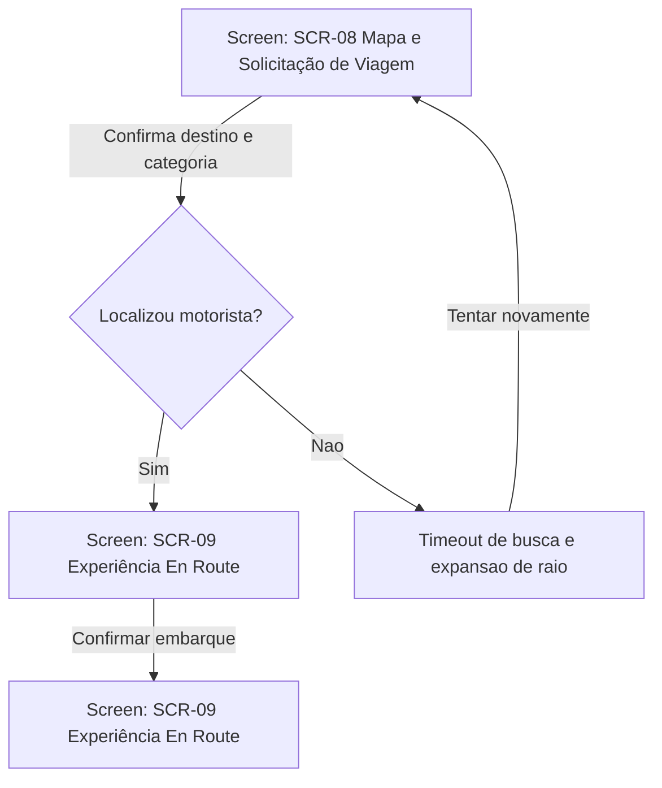

- **Screens traversed:**
  | Screen                                           | States used here                     |
  | ------------------------------------------------ | ------------------------------------ |
  | SCR-08 Mapa e Solicitação de Viagem              | success, loading, error              |
  | SCR-09 Experiência En Route                      | success                              |
  | SCR-14 Cockpit Operacional do Motorista          | success                              |
  | SCR-26 Agendamento de Corridas com Acordo Direto | default, success, negotiating, error |

### FLW-02: Cumprimento e Finalização de Corrida pelo Motorista

- **Traces:** ST-002 (JTBD-02, JRN-02/#2)
- **Goal:** Motorista aceita chamada no cockpit, cumpre o trajeto com navegação fluida e conclui a corrida
- **Entry points:** Cockpit operacional do motorista
- **Success exit:** Tela de recibo com ganho líquido somado e cockpit disponível para novas chamadas
- **Task analysis:**
  1. Motorista recebe card de oferta com detalhes de rota, distância até embarque e valor líquido
  2. Motorista aceita a corrida dentro da contagem regressiva de 15 segundos
  3. Navegação por GPS com interpolação projeta o trajeto até o passageiro
  4. Motorista confirma o embarque e inicia o deslocamento até o destino
  5. Ao chegar ao destino, motorista clica em finalizar corrida
- **Flow:**

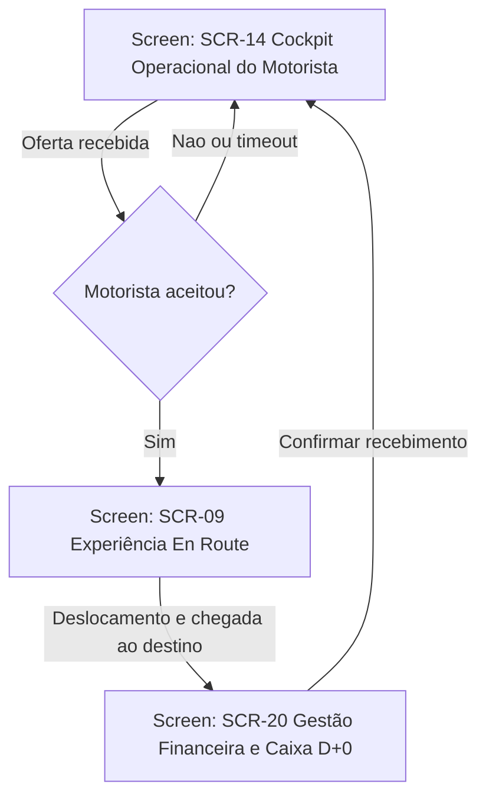

- **Screens traversed:**
  | Screen                                  | States used here |
  | --------------------------------------- | ---------------- |
  | SCR-09 Experiência En Route             | success          |
  | SCR-14 Cockpit Operacional do Motorista | success, error   |
  | SCR-20 Gestão Financeira e Caixa D+0    | success          |

### FLW-03: Gestão de Emergência e Acionamento de SOS

- **Traces:** ST-003 (JTBD-01, JRN-01/#4)
- **Goal:** Usuário em situação de perigo dispara o protocolo de segurança operacional e chamada para 190
- **Entry points:** Botão SOS em destaque permanente na tela de viagem
- **Success exit:** Alerta transmitido para a central de monitoramento com rota ao vivo e discador policial aberto
- **Task analysis:**
  1. Usuário toca no botão vermelho SOS de emergência
  2. Modal de confirmação ágil oferece opção de chamada 190 e compartilhamento de rota em link seguro
  3. Sistema eleva a frequência de telemetria GPS para streaming em tempo real
- **Flow:**

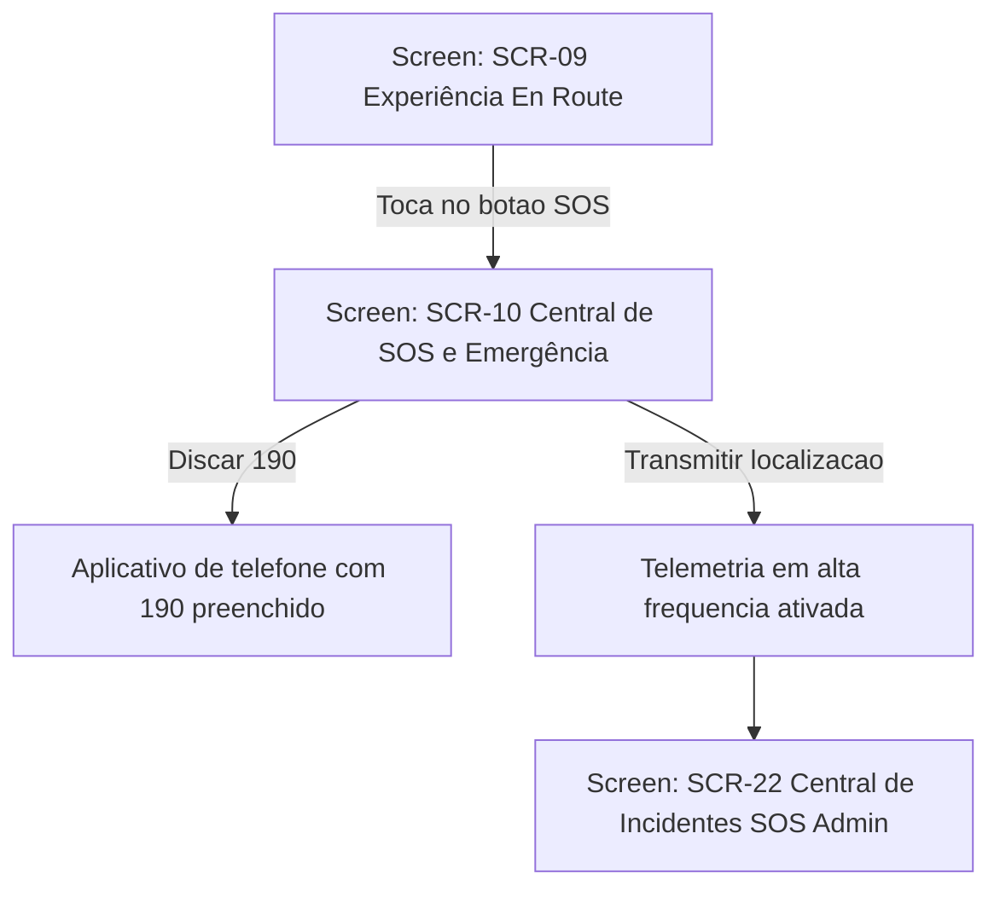

- **Screens traversed:**
  | Screen                                 | States used here |
  | -------------------------------------- | ---------------- |
  | SCR-09 Experiência En Route            | success          |
  | SCR-10 Central de SOS e Emergência     | success, error   |
  | SCR-22 Central de Incidentes SOS Admin | success          |

### FLW-04: Liquidação Financeira Instantânea com Split Pix

- **Traces:** ST-004 (JTBD-02, JRN-02/#5)
- **Goal:** Cobrança debitada e valor líquido transferido com liquidação imediata e registro contábil de partidas dobradas
- **Entry points:** Finalização da corrida pelo condutor
- **Success exit:** Saldo liberado no extrato do motorista com comprovante detalhado
- **Task analysis:**
  1. Encerramento da corrida dispara requisição idempotente de faturamento
  2. Gateway de pagamento processa liquidação via Pix
  3. Ledger contábil executa split entre franquia e condutor
  4. Extrato é atualizado em tempo real na interface
- **Flow:**

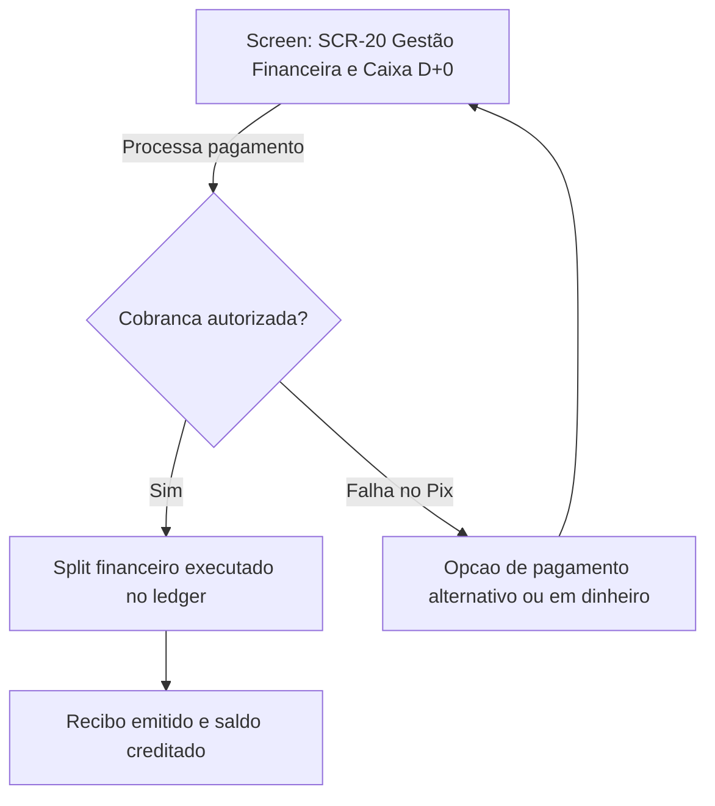

- **Screens traversed:**
  | Screen                                  | States used here |
  | --------------------------------------- | ---------------- |
  | SCR-14 Cockpit Operacional do Motorista | success          |
  | SCR-20 Gestão Financeira e Caixa D+0    | success, error   |

### FLW-05: Onboarding e Autenticação Unificada

- **Traces:** ST-005 (JTBD-01, JRN-01/#1)
- **Goal:** Apresentar a plataforma, permitir seleção entre passageiro e motorista e concluir o cadastro
- **Entry points:** Landing page pública ou splash inicial
- **Success exit:** Redirecionamento autenticado para o mapa do passageiro ou cockpit do motorista
- **Task analysis:**
  1. Usuário acessa a página inicial ou abre o app pela primeira vez
  2. Visualiza a splash e tela inicial de apresentação da marca
  3. Toca em Entrar ou Criar Conta e seleciona seu perfil
  4. Preenche credenciais e valida telefone
- **Flow:**

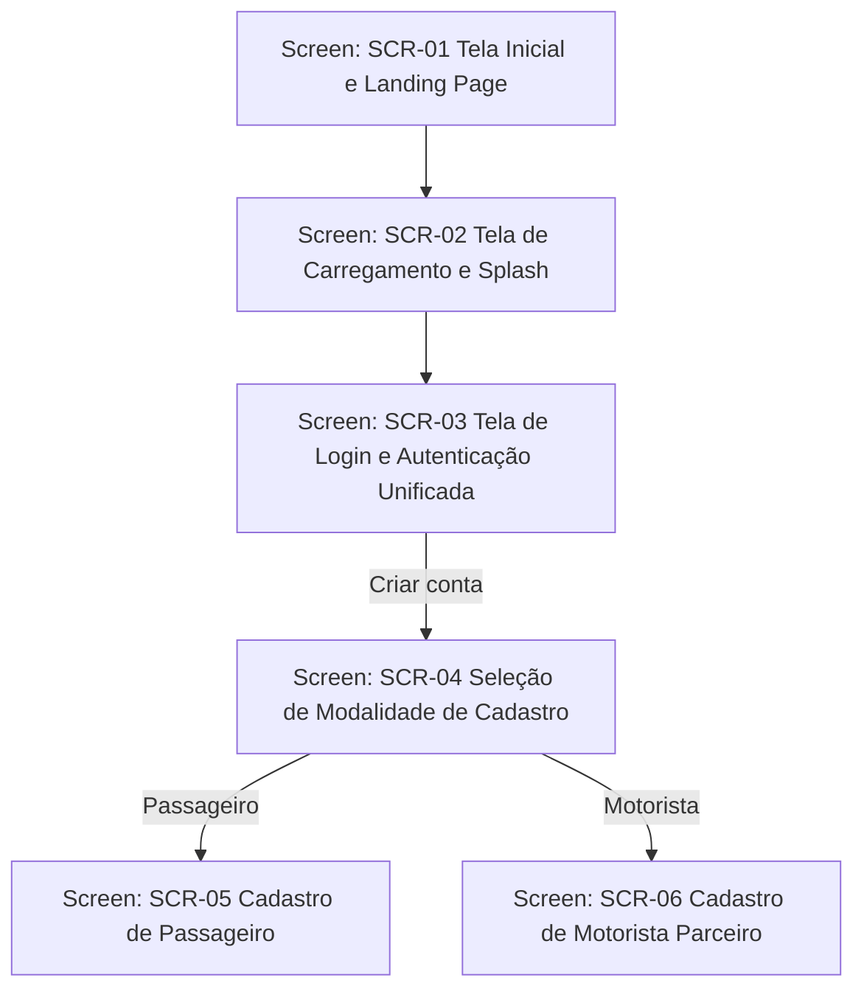

- **Screens traversed:**
  | Screen                                        | States used here        |
  | --------------------------------------------- | ----------------------- |
  | SCR-01 Tela Inicial e Landing Page            | success                 |
  | SCR-02 Tela de Carregamento e Splash          | success, loading        |
  | SCR-03 Tela de Login e Autenticação Unificada | success, error, loading |
  | SCR-04 Seleção de Modalidade de Cadastro      | success                 |
  | SCR-05 Cadastro de Passageiro                 | success, error          |
  | SCR-06 Cadastro de Motorista Parceiro         | success, error          |

### FLW-06: Resiliência Offline e Sincronização de Rede

- **Traces:** ST-006 (JTBD-01, JRN-01/#3)
- **Goal:** Proteger o estado da corrida durante quedas transitórias de conectividade
- **Entry points:** Oscilação de dados móveis em segundo plano
- **Success exit:** Banner de reconexão bem-sucedida e retomada contínua do mapa
- **Task analysis:**
  1. Conexão física de rede cai durante busca ou corrida ativa
  2. Banner não-intrusivo informa reconexão sem bloquear controles principais
  3. Conexão retorna e fila de eventos sincroniza no Supabase
- **Flow:**

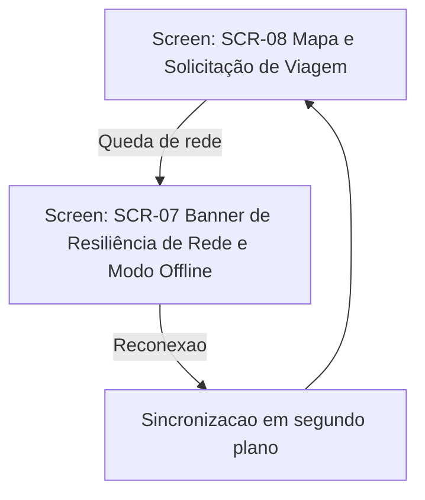

- **Screens traversed:**
  | Screen                                              | States used here |
  | --------------------------------------------------- | ---------------- |
  | SCR-07 Banner de Resiliência de Rede e Modo Offline | success, error   |
  | SCR-08 Mapa e Solicitação de Viagem                 | success          |
  | SCR-14 Cockpit Operacional do Motorista             | success          |

### FLW-07: Consulta de Histórico e Encomendas

- **Traces:** ST-007 (JTBD-01, JRN-01/#5)
- **Goal:** Permitir ao usuário consultar corridas anteriores, gerenciar perfil e solicitar entregas
- **Entry points:** Menu inferior do passageiro
- **Success exit:** Comprovante exibido ou entrega despachada
- **Task analysis:**
  1. Usuário toca na aba Atividade ou Encomendas
  2. Consulta comprovantes ou preenche dados do pacote
  3. Atualiza dados e foto no perfil
- **Flow:**

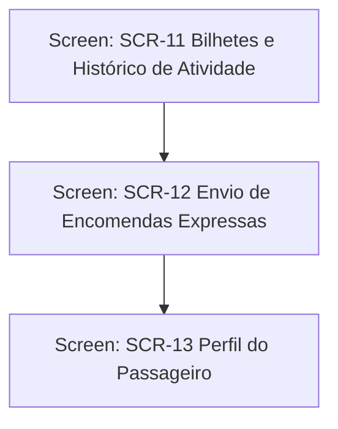

- **Screens traversed:**
  | Screen                                   | States used here      |
  | ---------------------------------------- | --------------------- |
  | SCR-11 Bilhetes e Histórico de Atividade | success, empty, error |
  | SCR-12 Envio de Encomendas Expressas     | success, error        |
  | SCR-13 Perfil do Passageiro              | success, error        |

### FLW-08: Governança e Painel Administrativo

- **Traces:** ST-008 (JTBD-03, JRN-01/#2)
- **Goal:** Fornecer ao gestor visão global de telemetria, aprovação de condutores e personalização
- **Entry points:** Rota administrativa restrita (/app/admin)
- **Success exit:** Decisão executiva aplicada e sincronizada no cluster
- **Task analysis:**
  1. Administrador faz login no painel de comando
  2. Audita frotas no mapa e analisa solicitações de credenciamento
  3. Ajusta cores e parâmetros no White Label Studio
- **Flow:**

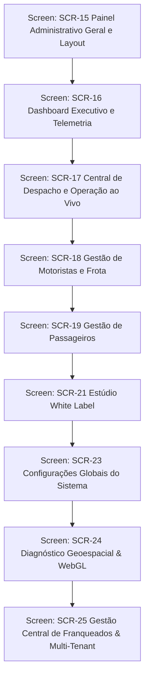

- **Screens traversed:**
  | Screen                                              | States used here |
  | --------------------------------------------------- | ---------------- |
  | SCR-15 Painel Administrativo Geral e Layout         | success          |
  | SCR-16 Dashboard Executivo e Telemetria             | success          |
  | SCR-17 Central de Despacho e Operação ao Vivo       | success          |
  | SCR-18 Gestão de Motoristas e Frota                 | success          |
  | SCR-19 Gestão de Passageiros                        | success          |
  | SCR-21 Estúdio White Label                          | success          |
  | SCR-23 Configurações Globais do Sistema             | success          |
  | SCR-24 Diagnóstico Geoespacial & WebGL              | success          |
  | SCR-25 Gestão Central de Franqueados & Multi-Tenant | success          |

### FLW-09: Despacho Consecutivo e Navegação Externa no Cockpit

- **Traces:** ST-009, ST-010, ST-011, ST-012 (JTBD-02, JRN-02/#3, JRN-02/#4)
- **Goal:** Condutor opera com navegação Waze/Maps com 1 toque, recebe próxima corrida em fila e opera sob modo de tolerância diária
- **Entry points:** Cockpit operacional do motorista (/app/motorista)
- **Success exit:** Viagem consecutiva aceita e transição fluida sem tempo ocioso
- **Task analysis:**
  1. Motorista em deslocamento ou viagem toca no botão flutuante para navegar no Waze ou Google Maps com destino pré-preenchido
  2. Motor de proteção verifica integridade do GPS e exibe selo verde de sinal autêntico
  3. A menos de 2 minutos do desembarque, surge o card de chamada em cadeia próxima ao ponto de entrega
  4. Motorista aceita a corrida em fila com 1 toque
  5. Ao concluir o desembarque atual, o sistema migra automaticamente para o embarque da próxima chamada
- **Flow:**

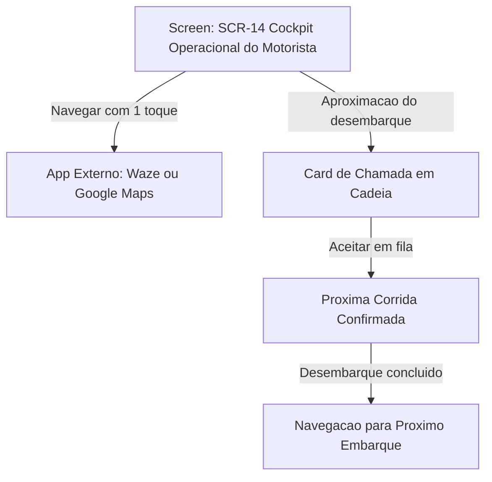

- **Screens traversed:**
  | Screen                                  | States used here |
  | --------------------------------------- | ---------------- |
  | SCR-14 Cockpit Operacional do Motorista | success, offer   |

### FLW-10: Torre de Controle Preditiva e Disparo de Incentivo Operacional

- **Traces:** ST-013 (JTBD-03, JRN-01/#2)
- **Goal:** Franqueado identifica clusters de demanda reprimida e aciona incentivo de tarifa para atrair motoristas
- **Entry points:** Central de Despacho (/app/admin/despacho)
- **Success exit:** Alerta transmitido para a frota do perímetro
- **Task analysis:**
  1. Administrador acessa a Central de Despacho e abre a Torre de Demanda Preditiva
  2. Analisa clusters com alta taxa de desbalanceamento entre passageiros e motoristas
  3. Clica em disparar alerta de incentivo com sobretaxa sugerida
  4. Condutores na região recebem notificação de oportunidade de ganhos imediatos
- **Flow:**

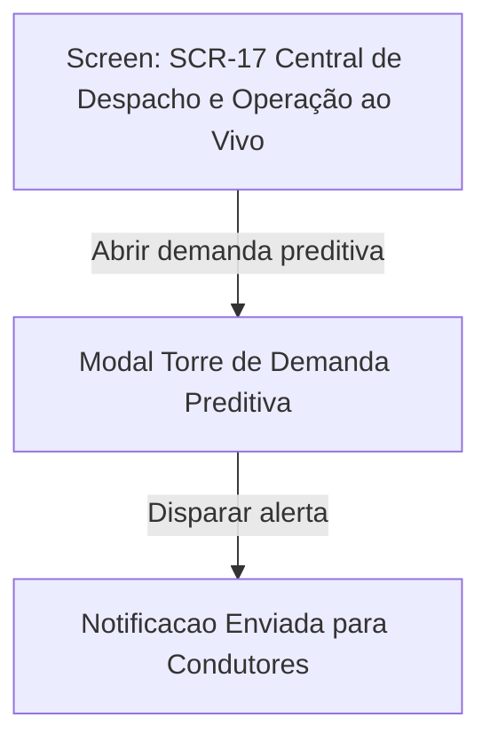

- **Screens traversed:**
  | Screen                                        | States used here |
  | --------------------------------------------- | ---------------- |
  | SCR-17 Central de Despacho e Operação ao Vivo | success          |

### FLW-11: Homologação Expressa com OCR e CRM de Reengajamento

- **Traces:** ST-014, ST-015 (JTBD-03, JRN-01/#2)
- **Goal:** Administrador homologa motorista com leitura ótica de CNH e dispara campanhas para usuários inativos
- **Entry points:** Gestão de Motoristas (/app/admin/motoristas) e Painel Executivo (/app/admin)
- **Success exit:** Motorista homologado em minutos ou campanha de reativação enviada
- **Task analysis:**
  1. Administrador clica em Validação Expressa (OCR CNH) na tabela de motoristas pendentes
  2. Confere dados extraídos (registro, validade e EAR) e clica em homologar com 1 toque
  3. No painel executivo, abre o CRM de Reengajamento e dispara incentivo para usuários inativos
- **Flow:**

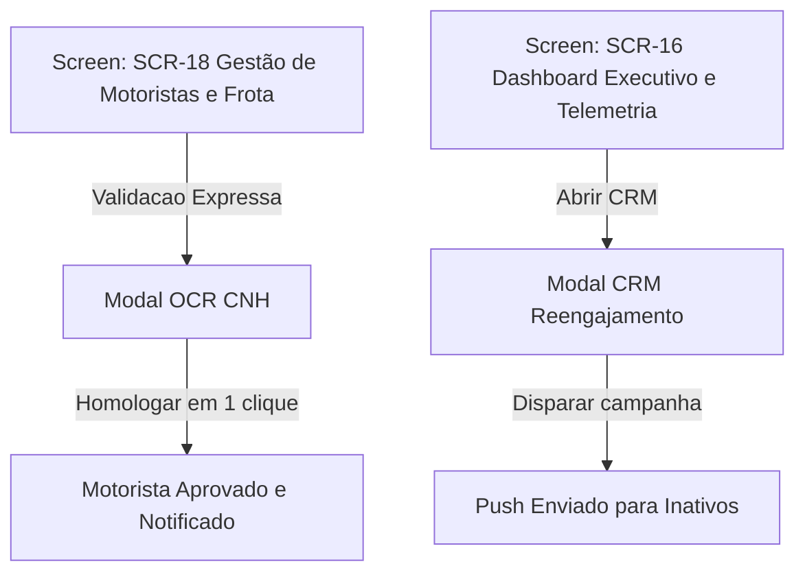

- **Screens traversed:**
  | Screen                                  | States used here |
  | --------------------------------------- | ---------------- |
  | SCR-16 Dashboard Executivo e Telemetria | success          |
  | SCR-18 Gestão de Motoristas e Frota     | success          |

### FLW-12: Resiliência Zero-Drop e Sincronização Segura Offline

- **Traces:** ST-016 (JTBD-01, JRN-01/#3)
- **Goal:** Preservar integridade de corridas e lançamentos contábeis durante travessia em áreas sem sinal de internet
- **Entry points:** App do passageiro ou motorista em trânsito
- **Success exit:** Eventos locais sincronizados e validados com o banco central
- **Task analysis:**
  1. Veículo entra em túnel ou área rural sem sinal 4G
  2. Motorista confirma embarque ou desembarque; sistema registra evento em IndexedDB local com hash criptográfico
  3. Ao restabelecer conectividade de rede, motor Zero-Drop processa a fila de outbox e liquida transações sem perda de dados
- **Flow:**

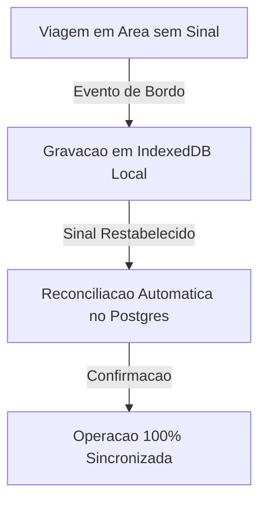

- **Screens traversed:**
  | Screen                                       | States used here |
  | -------------------------------------------- | ---------------- |
  | SCR-07 Banner de Resiliência de Rede e Modo Offline | offline, online |
  | SCR-14 Cockpit Operacional do Motorista      | success          |

### FLW-13: Sobrevivência Urbana e Áudio HUD no Cockpit

- **Traces:** ST-017, ST-018, ST-019 (JTBD-02, JRN-02/#1, JRN-02/#2, JRN-02/#4)
- **Goal:** Condutor opera com proteção contra bairros de risco, ativa rota de volta para casa com 1 toque e recebe ofertas anunciadas por voz hands-free
- **Entry points:** Cockpit operacional do motorista (/app/motorista)
- **Success exit:** Filtros de sobrevivência ativos e chamada aceita com condução segura
- **Task analysis:**
  1. Motorista cadastra até 3 zonas de exclusão pessoal para o horário noturno
  2. Ao final do turno, aciona o chip de rota para casa com destino favorito pré-configurado
  3. Ativa o Áudio HUD para ouvir dados da corrida por síntese de voz no fone ou alto-falante
  4. Avalia e aceita chamada sem desviar o olhar do trânsito
- **Flow:**

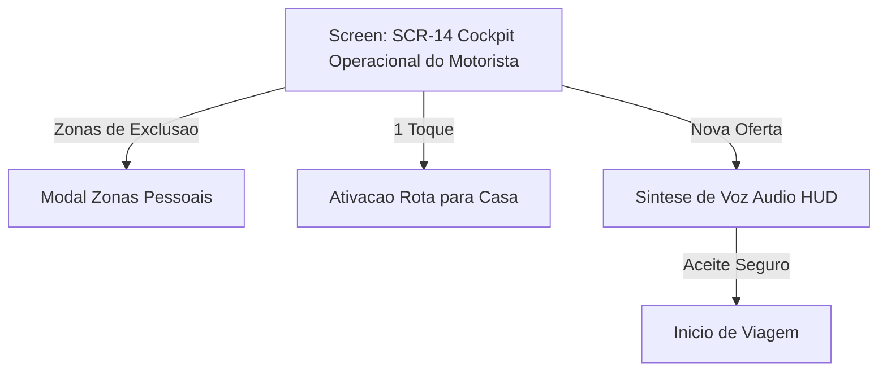

- **Screens traversed:**
  | Screen                                  | States used here |
  | --------------------------------------- | ---------------- |
  | SCR-14 Cockpit Operacional do Motorista | success, offer   |
