# 02. Stack Tecnológica e Infraestrutura (Enterprise V6.0)

---

## 1. Visão Geral da Pilha Tecnológica

O **PARTIU MOBE** utiliza uma arquitetura moderna, reativa e de altíssimo desempenho, construída integralmente em TypeScript com foco em tempo de resposta submétrico, tolerância a falhas e máxima segurança de dados.

```mermaid
graph TB
    subgraph Frontend ["🎨 Camada de Apresentação (Frontend)"]
        React["React 19.2 (Concurrent Features)"]
        TanStack["TanStack Router 1.170 & Start (Nitro SSR)"]
        Tailwind["TailwindCSS v4.2 + oklch Color Space"]
        RadixUI["Radix UI Primitives (WAI-ARIA WCAG)"]
        Mapbox["Mapbox GL 3.29 3D & H3-js (Uber Hexagonal Spatial)"]
    end

    subgraph BuildAndRuntime ["⚡ Build Tools & Serverless Engine"]
        Vite["Vite 8.1.5 + Rollup"]
        TypeScript["TypeScript 5.8 (Strict Mode Integral)"]
        Nitro["Nitro 3.0 Engine (.vercel/output/nitro.json)"]
    end

    subgraph BackendAndDB ["💾 Backend & Persistência"]
        Supabase["Supabase Cloud / PostgreSQL 15+"]
        PostGIS["PostGIS 3.3 (Extensões Geoespaciais)"]
        SupabaseRealtime["Supabase Realtime (WebSockets Elixir/Phoenix)"]
        EdgeFunctions["Edge Functions com Fallback Geodésico Haversine"]
    end

    subgraph SecurityLayer ["🛡️ Segurança, FinOps & Sanitização"]
        Ed25519["Ed25519 RFC 8032 (Criptografia Assimétrica)"]
        HMAC["HMAC-SHA256 (Validação Anti-Tamper de Webhooks)"]
        Idempotency["Idempotency Keys Engine (Anti-Replay)"]
        Ledger["Double-Entry Bookkeeping Ledger (FinOps)"]
        Sanitization["Sanitização P0: Variáveis de Ambiente & Zero Credenciais Hardcoded"]
    end

    Frontend --> BuildAndRuntime
    BuildAndRuntime --> BackendAndDB
    BackendAndDB --> SecurityLayer
```

---

## 2. Detalhamento dos Componentes

### A. Frontend (Single Page Application, SSR Nitro & PWA)
- **React 19.2.0:** Uso extensivo de recursos concorrentes, transições otimistas (`useOptimistic`), renderização fluida sem travamento de thread visual e suporte a Server-Side Rendering via TanStack Start.
- **TanStack Router 1.170.41:** Roteamento 100% estritamente tipado (*type-safe*), com geração automática de rotas (`routeTree.gen.ts`), separação modular entre cockpit de passageiro, motorista e painel corporativo do franqueado.
- **TanStack Start & Nitro Engine:** Suporte a Server-Side Rendering (SSR) e pré-renderização estática de alto desempenho, compilando diretamente para o artefato de produção `.vercel/output/nitro.json` em menos de 3 segundos.
- **TailwindCSS 4.2.1:** Nova geração do motor CSS com compilação ultra-rápida, espaço de cor perceptual `oklch`, paleta monocromática elegante e tokens integrados via `@theme inline`.
- **Radix UI Primitives:** Conjunto de primitivas sem estilo prévio que assegura conformidade total com acessibilidade WCAG 2.1 AA (foco por teclado, anúncios de leitores de tela e gerenciamento de modais).
- **Mapbox GL JS 3.29.0 & h3-js 4.5.0:**
  - Renderização 3D com estilo monocromático minimalista (`mapbox://styles/mapbox/light-v11`).
  - Supressão em tempo de execução de rótulos de comércio (`poi-label`) e divisões administrativas (`transit-label`).
  - Billboarding 2.5D com veículos 3D pré-injetados via GPU (Base64 Data URI) e alinhamento à via.
  - Malhas espaciais hexagonais Uber H3 para mapas de calor e zoneamento dinâmico.

### B. Backend & Banco de Dados (Supabase & PostgreSQL)
- **PostgreSQL 15+:** Banco de dados relacional primário com propriedades ACID rigorosas, transações atômicas com `FOR UPDATE` para prevenção de overbooking de assentos e isolamento serializável.
- **PostGIS 3.3:** Extensão espacial corporativa utilizada para:
  - Busca de motoristas em raio geográfico com `ST_DWithin` e `ST_DistanceSphere`.
  - Geofencing de perímetros territoriais municipais de franquias regionais.
  - Índices espaciais de alta performance `GIST` em coordenadas geográficas.
- **Supabase Realtime:** Infraestrutura distribuída em Elixir/BEAM responsável por canais de WebSockets com entrega sub-100ms para:
  - Telemetria contínua e rastreamento de veículos em tempo real.
  - Alertas de despacho concorrente (*ringing*) com contagem regressiva de 15 segundos.
  - Chat em tempo real criptografado entre passageiro e motorista com sanitização de PII.
  - Sinais de desbloqueio instantâneo após pagamento de mensalidade Pix SaaS.
- **Supabase Edge Functions:** Funções serverless com tolerância a falhas e chaveamento inteligente (ex: Mapbox API com fallback para cálculo geodésico Haversine).

### C. Camada de Segurança, FinOps & Governança de Credenciais
- **Sanitização de Credenciais (P0):** Zero segredos ou credenciais de banco de dados gravadas em código-fonte. Todo o acesso administrativo ao banco de dados requer e consome `process.env.DATABASE_URL` carregado de forma protegida em tempo de execução.
- **Ed25519 (RFC 8032):** Assinatura e verificação assimétrica para emissão de bilhetes de transporte offline com chave privada isolada no servidor e chave pública distribuída nos validadores veiculares.
- **HMAC-SHA256:** Assinatura criptográfica aplicada em webhooks de pagamento Pix (Mercado Pago, Asaas, PicPay, EFI Bank) com janela de tolerância temporal estrita de 5 minutos contra ataques de replay.
- **Global Idempotency Engine:** Validação com chave `Idempotency-Key` (RFC 7240) associada a hash do payload, prevenindo processamentos financeiros ou despachos duplicados.
- **Double-Entry Bookkeeping Ledger:** Registro contábil com garantia imutável `SUM(Débitos) === SUM(Créditos)` operando exclusivamente em centavos inteiros (*minor units*).

---

## 3. Matriz de Dependências Principais

| Pacote | Versão | Função Primária |
| :--- | :--- | :--- |
| `react` / `react-dom` | `^19.2.0` | Framework de interface declarativa e concorrente |
| `@tanstack/react-router` | `1.170.41` | Sistema de roteamento estritamente tipado |
| `@tanstack/react-query` | `^5.101.1` | Gerenciamento de estado de servidor e cache |
| `nitro` | `^3.0.0` | Motor de build e runtime SSR para Vercel Serverless |
| `tailwindcss` | `^4.2.1` | Motor de estilização utilitária com suporte a oklch |
| `@supabase/supabase-js` | `^2.112.4` | SDK de conexão ao PostgreSQL, Auth e Realtime |
| `h3-js` | `^4.5.0` | Malhas espaciais hexagonais para indexação de demanda |
| `mapbox-gl` | `^3.29.0` | Mapas vetoriais WebGL com billboarding e 3D buildings |
| `zod` | `^3.24.2` | Validação de esquemas e contratos de dados |
| `date-fns` | `^4.1.0` | Manipulação precisa de datas e carências de assinatura |
| `qrcode` | `^1.5.4` | Geração de QR Codes Pix dinâmicos com chave EMV |

---

## 4. Topologia de Infraestrutura em Produção

```mermaid
flowchart LR
    subgraph CDN_Edge ["🌐 Edge Global & CDN (Vercel)"]
        VercelEdge["Vercel Edge Network / SSL TLS 1.3"]
        NitroSSR["Nitro Serverless SSR Engine"]
    end

    subgraph Compute ["⚙️ Computação & Orquestração"]
        SPA["Single Page App (Static Assets Brotli/Gzip)"]
        EdgeAPI["Supabase Edge Functions (Deno Runtime)"]
    end

    subgraph DataCore ["🏛️ Supabase Cluster (AWS / Multi-AZ)"]
        PGPrimary["Postgres 15 Primary (Escrita, ACID & RLS)"]
        PGReplica["Postgres Read Replica (Consultas & Relatórios)"]
        RealtimeCluster["Realtime WebSocket Nodes (Phoenix Cluster)"]
        S3Bucket["Object Storage (Buckets Privados CNH/CRLV)"]
    end

    CDN_Edge --> Compute
    Compute --> DataCore
```

- **Resiliência e SLA:** Arquitetura desacoplada onde a instabilidade de um gateway terceiro de pagamento não compromete o motor de despacho geográfico.
- **Cache Estratégico:** Cabeçalhos `Cache-Control: public, max-age=31536000, immutable` para assets compilados e `no-store, no-cache, must-revalidate` para dados transacionais sensíveis.
