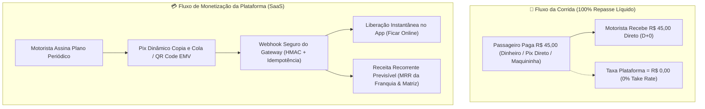
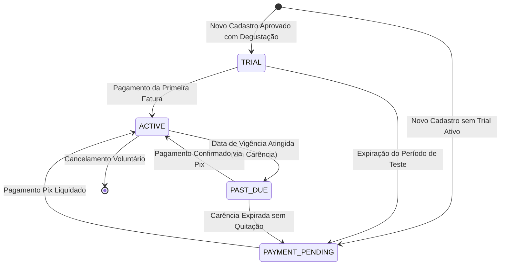

# 04. Modelo de Negócio e Estratégia de Monetização SaaS (Enterprise V6.0)

---

## 1. Diretriz Estratégica Fundamental (North Star)

O modelo de negócios do **PARTIU MOBE** foi estruturado em torno de uma premissa imutável:

> **TAXA ZERO POR CORRIDA (0% TAKE RATE):**  
> O motorista parceiro fica com **100% do valor bruto** de cada viagem realizada. A plataforma **NÃO retém comissões percentuais** nem desconta créditos fracionados a cada corrida concluída.

A monetização da plataforma decorre **exclusivamente de assinaturas de acesso (_Software as a Service - SaaS_)** pagas periodicamente pelos condutores cadastrados.



---

## 2. Catálogo Oficial de Planos de Assinatura

Os planos são parametrizáveis no Painel Administrativo (`/app/admin/monetizacao`) e contemplam diferentes perfis de trabalho (motoristas em tempo integral, condutores de fins de semana e iniciantes em teste):

| Identificador      | Nome do Plano                | Periodicidade        | Preço Sugerido (BRL) | Dias de Carência | Período de Degustação (_Trial_) | Take Rate por Corrida |
| :----------------- | :--------------------------- | :------------------- | :------------------- | :--------------- | :------------------------------ | :-------------------- |
| `plano_diario_24h` | **Diária Express (24h)**     | Diário (1 dia)       | R$ 12,00             | 0 dias           | 0 dias                          | **0,0%**              |
| `plano_semanal`    | **Semanal Flex**             | Semanal (7 dias)     | R$ 45,00             | 1 dia            | 0 dias                          | **0,0%**              |
| `plano_mensal_pro` | **Mensal Pro (Recomendado)** | Mensal (30 dias)     | R$ 149,90            | 3 dias           | 3, 7 ou 30 dias (configurável)  | **0,0%**              |
| `plano_trimestral` | **Trimestral Fidelidade**    | Trimestral (90 dias) | R$ 389,00            | 5 dias           | 0 dias                          | **0,0%**              |
| `plano_anual_vip`  | **Anual VIP Platinum**       | Anual (365 dias)     | R$ 1.290,00          | 7 dias           | 0 dias                          | **0,0%**              |

### Configurador Visual de Trial (Degustação):

O administrador pode selecionar a política de degustação para novos motoristas aprovados:

- **Desativado (0 dias):** Exige contratação de plano imediatamente após aprovação documental.
- **Trial Rápido (3 dias):** Ideal para onboarding agressivo com conversão rápida.
- **Trial Padrão (7 dias):** Recomendado para maturação da praça e adesão inicial da frota.
- **Trial Expansão (30 dias):** Utilizado no lançamento de novas cidades ou franquias para povoar a base de condutores.

---

## 3. Ciclo de Vida da Assinatura e Avaliação de Acesso

A conta de cada motorista transita por quatro estados finitos rigorosamente controlados pelo `DriverSubscriptionService`:



### Detalhamento dos Estados de Acesso:

1. **`TRIAL` (Em Período de Degustação Grátis):**
   - Concedido automaticamente na aprovação documental conforme configuração da praça.
   - Motorista tem acesso pleno e irrestrito ao recebimento de chamados com 0% de comissão.
2. **`ACTIVE` (Assinatura Ativa e Regular):**
   - Mensalidade quitada e dentro do prazo de vigência (`validade_assinatura >= NOW()`).
   - Elegibilidade total no motor de despacho geográfico (`MatchingEngine`).
3. **`PAST_DUE` (Em Período de Tolerância / Carência):**
   - Assinatura venceu, mas o condutor está dentro dos dias de tolerância configurados para o plano.
   - O aplicativo exibe banner amarelo de aviso, mantendo o botão "Ficar Online" ativo para não interromper viagens no meio da jornada.
4. **`PAYMENT_PENDING` (Inadimplente / Bloqueado para Chamadas):**
   - Prazo de carência encerrado sem pagamento.
   - O aplicativo desabilita o toggle "Ficar Online" e exibe tela de cobrança com Pix Copia e Cola.
   - O `MatchingEngine` exclui o condutor imediatamente de qualquer busca de despacho.

---

## 4. Ciclo de Cobrança PIX & Idempotência Transacional

A plataforma integra-se a múltiplos provedores Pix autorizados pelo BACEN (Mercado Pago, Asaas, PicPay e EFI Bank):

1. **Criação de Cobrança com Metadados Preservados:**
   - Ao gerar o Pix, o sistema registra identificador único, plano, ciclo de vigência e `tenant_id` da franquia.
   - É gerado um payload EMV padrão BACEN com QR Code em tempo real.
2. **Idempotência Estrita na Confirmação:**
   - Webhooks recebidos contêm `Idempotency-Key` ou `payment_id` único do gateway.
   - Retentativas do mesmo webhook confirmam o pagamento com sucesso sem duplicar prazos ou conceder dias adicionais indevidos.
3. **Liberação Reativa em Milissegundos:**
   - O banco atualiza a vigência (`validade_assinatura += periodo_dias`).
   - Um evento via WebSocket do Supabase Realtime é transmitido para o app do motorista, desbloqueando a interface instantaneamente.

---

## 5. Auditoria Administrativa, Cortesia & Separação Contábil

### Concessão de Dias de Cortesia:

Operadores autorizados no painel executivo podem conceder dias adicionais de bonificação para um motorista (por exemplo, 3 a 30 dias em caso de premiação ou resolução de suporte):

- A ação registra um evento imutável de auditoria contendo: ID do administrador, justificativa operacional, data/hora e saldo de dias estendido.

### Separação Contábil Estrita (Zero Confisco de Ganhos):

- Os saques e repasses relativos às corridas concluídas pelos motoristas são **100% isolados** do sistema de cobrança de mensalidades.
- A plataforma **NÃO realiza débitos automáticos** de mensalidades sobre os ganhos de corridas dos motoristas.
- O motorista possui soberania total sobre seus rendimentos de transporte.

---

## 6. Regra de Ouro no Motor de Despacho (Matching Engine)

A regra de ouro da monetização está embutida diretamente na cláusula de consulta espacial do PostgreSQL:

```sql
-- Cláusula Mandatória de Despacho no PostgreSQL:
SELECT motorista_id, ST_Distance(geom, passageiro_geom) as distancia
FROM motoristas_ativos
WHERE documentos_aprovados = true
  AND status_operacional = 'ONLINE'
  AND status_assinatura IN ('ACTIVE', 'TRIAL')
  AND validade_assinatura >= NOW()
ORDER BY distancia ASC
LIMIT 10;
```

> **Blindagem de Domínio:** Se o motorista não estiver com assinatura válida (`ACTIVE` ou `TRIAL`), ele é categoricamente desconsiderado no cálculo espacial, garantindo a sustentabilidade financeira da operação.

---

## 7. Repasse de Royalties entre Matriz e Franquias Regionais

Nas praças operadas por franqueados:

- **Royalties das Assinaturas:** O franqueado regional retém entre **70% e 90%** do valor líquido das assinaturas pagas pelos motoristas cadastrados em sua praça.
- **Taxa Tecnológica da Matriz:** A matriz da plataforma retém entre **10% e 30%** para cobrir custos de infraestrutura em nuvem, servidores PostGIS, CDN, mapas e desenvolvimento contínuo.
- **Corridas:** Nenhuma taxa é deduzida das corridas (0% de take rate em qualquer nível da organização).

---

## 8. Métricas Executivas SaaS

O painel de gestão executiva (`/app/admin/monetizacao`) acompanha em tempo real:

- **MRR (Monthly Recurring Revenue):** Receita recorrente mensal acumulada.
- **ARR (Annual Recurring Revenue):** Faturamento anual projetado (`MRR * 12`).
- **LTV (Lifetime Value):** Tempo médio de retenção multiplicado pela mensalidade média.
- **CAC (Customer Acquisition Cost):** Custo de aquisição por novo motorista ativo.
- **Taxa de Churn:** Percentual de cancelamento ou não renovação de assinaturas.
- **Economia Gerada para a Frota:** Valor total que os motoristas deixaram de pagar para Uber/99 graças ao modelo Taxa Zero do PARTIU.
