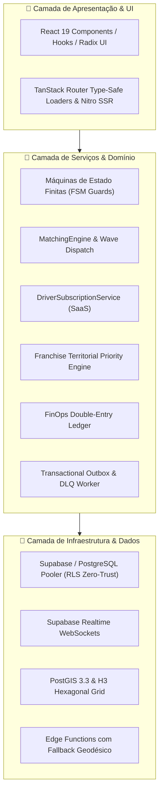
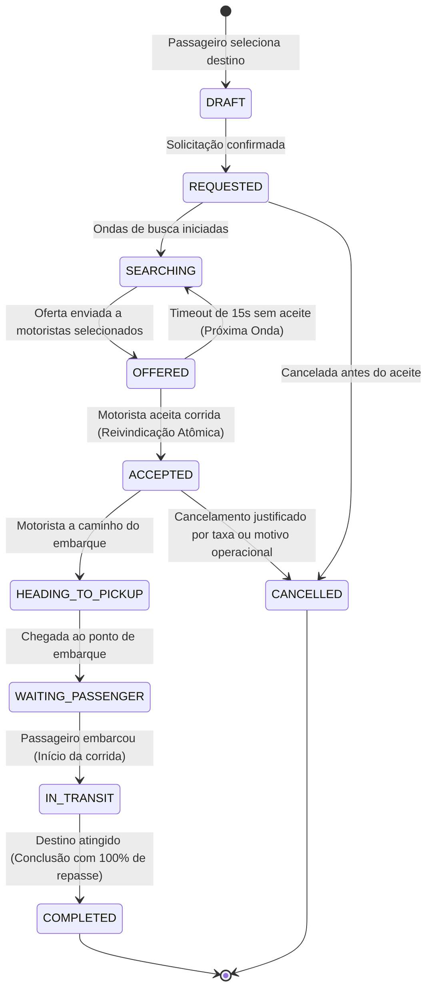
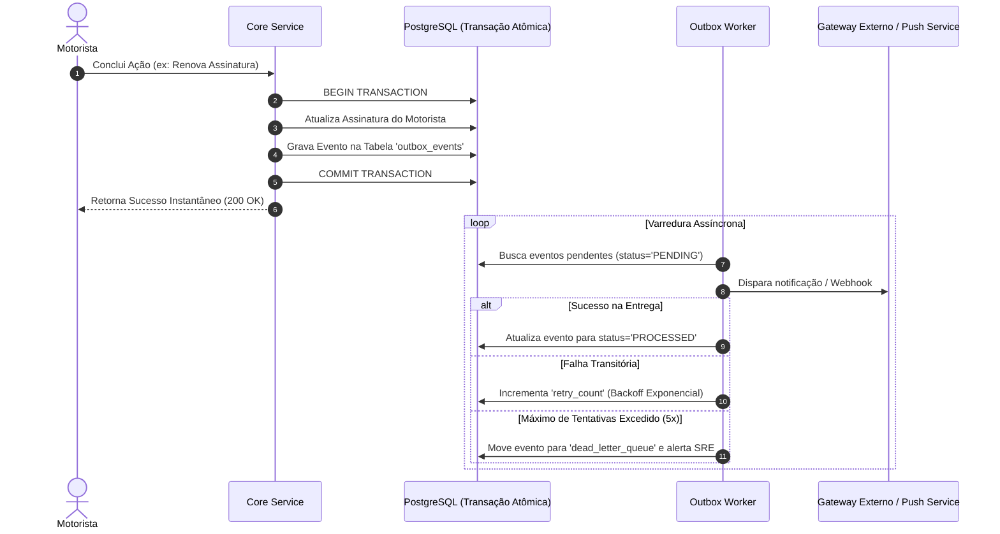

# 05. Arquitetura de Software e Engenharia de Sistemas (Enterprise V6.0)

---

## 1. Visão Geral dos Padrões Arquiteturais

A engenharia do **PARTIU MOBE** foi projetada para suportar missões críticas com tolerância a falhas, concorrência agressiva e integridade matemática absoluta. A estrutura segue os princípios de **Clean Architecture**, **Domain-Driven Design (DDD)** e padrões corporativos consolidados (_ByteByteGo 2025 Architecture Standards_).

---

## 2. Máquinas de Estado Finitas do Domínio (Finite State Machines - FSM)

Para prevenir transições inválidas, inconsistências de telas e race conditions concorrentes, os objetos centrais da aplicação são controlados por **máquinas de estados estritas com travas de guarda (_guards_)**:

### A. Máquina de Estados da Corrida (Ride FSM)

Controla o ciclo de vida completo de uma viagem entre passageiro e motorista:

_Invariante de Segurança:_ Qualquer tentativa de transição fora da sequência (exemplo: transitar de `DRAFT` diretamente para `COMPLETED`) dispara erro em nível de serviço e no banco, abortando a transação.

### B. Máquina de Estados do Dispositivo do Motorista

Controla a autorização de aparelhos cadastrados para prevenir clonagem de contas e fraude de telemetria:

- `REGISTERED` (Cadastrado) $\to$ `PAIRED` (Pareado com CNH) $\to$ `ACTIVE` (Autorizado) $\to$ `REVOKED` (Revogado por Suspeita).
- _Regra Imutável:_ Dispositivos com status `REVOKED` têm qualquer requisição de despacho ou telemetria rejeitada imediatamente com código `DEVICE_REVOKED`.

---

## 3. FinOps: Ledger Contábil de Dupla Entrada (Double-Entry Bookkeeping)

Todas as transações monetárias (pagamento de mensalidades, faturas SaaS, créditos institucionais e repasses de royalties para franquias) são registradas em uma tabela de **Ledger Imutável** com precisão em centavos inteiros (_minor units_ — formato BigInt/Inteiro):

### Regras do Motor Contábil:

1. **Balanço Zero Inegociável:** Cada operação gera obrigatoriamente duas ou mais entradas contábeis balanceadas. A soma aritmética dos débitos deve ser exatamente igual à soma dos créditos:
   $$\sum \text{Débitos} \equiv \sum \text{Créditos}$$
2. **Proibição de UPDATE e DELETE:** O livro contábil é estritamente _Append-Only_. Erros ou estornos operacionais são tratados gerando um novo registro de contrapartida (estorno contábil rastreável com `idempotency_key`).
3. **Prevenção de Floating-Point Rounding:** Valores monetários nunca utilizam tipos de ponto flutuante (`float`, `double`) no JavaScript ou no SQL. R$ 149,90 é representado rigorosamente como o número inteiro `14990`.

---

## 4. Padrão Transactional Outbox e Dead-Letter Queue (DLQ)

Para garantir que notificações push, mensagens no WhatsApp, webhooks para franquias e eventos de telemetria nunca sejam perdidos em caso de falha transitória de rede, o sistema implementa o padrão **Transactional Outbox**:

---

## 5. Motor de Idempotência Global (Anti-Duplication Engine)

Para mitigar problemas de perda de conexão móvel onde o motorista ou passageiro clica repetidamente sob oscilação de 3G/4G, a API implementa o cabeçalho obrigatório:
`Idempotency-Key: <UUIDv4>`

- **Primeira Requisição:** Executa o processamento normalmente e armazena o hash criptográfico do payload de entrada e a resposta serializada na tabela `idempotency_records` por 24 horas.
- **Requisições Repetidas (com mesmo payload):** Retornam instantaneamente o resultado idêntico armazenado no cache do banco sem reexecutar lógica de negócio ou debitar pagamentos adicionais.
- **Requisições com Mesma Chave e Payload Diferente:** Rejeitadas com o código de erro `409 Conflict` (`IDEMPOTENCY_PAYLOAD_MISMATCH`).

---

## 6. Arquitetura Geoespacial e Despacho Concorrente (PostGIS + H3)

O motor de localização e matching foi construído para lidar com centenas de atualizações de GPS por segundo sem sobrecarregar o banco de dados:

### A. Deadband Geográfico e Throttle de Escrita

Em trânsito urbano, veículos parados em semáforos ou congestionamentos geram leituras de GPS repetitivas. O `DynamicGpsProfileManager` aplica as seguintes regras:

- **Veículo Parado (deslocamento < 20 metros e intervalo < 15 segundos):** O ponto GPS **NÃO** é persistido no banco de dados principal, suprimindo mais de 34% de escritas desnecessárias no banco de dados.
- **Veículo em Movimento (deslocamento $\ge$ 20 metros):** Ponto transmitido imediatamente via WebSocket Realtime e persistido em buffer.
- **Heartbeat Temporal de Liveness:** Se o veículo permanecer mais de 15 segundos sem se mover, transmite um batimento cardíaco leve para confirmar que o motorista continua online e conectado à rede.

### B. Despacho Concorrente em Ondas (_Wave Dispatch_)

Quando um passageiro solicita uma corrida:

1. O `MatchingEngine` identifica motoristas elegíveis num raio inicial de 2 km usando PostGIS `ST_DWithin`.
2. A corrida é ofertada à primeira onda com janela de contagem regressiva de 15 segundos.
3. **Prevenção de Race Condition:** O aceite do motorista é executado via **RPC Atômica no PostgreSQL** com bloqueio pessimista de linha (`SELECT FOR UPDATE`). Se múltiplos motoristas clicarem no mesmo milissegundo, exatamente um vence a disputa e os demais recebem resposta graciosa sem deadlocks.

---

## 7. Geofencing & Prioridade Territorial de Franquias (Suíte 39)

O motor de governança geográfica opera em três camadas:

1. **Base Canônica de Cidades:** Mapeamento de todos os municípios brasileiros com cálculo Haversine geodésico para determinação de distâncias e adjacências territoriais.
2. **Matriz Nacional (Franquia Mãe):** Possui flag de cobertura irrestrita em todo o Brasil. Caso uma localidade ainda não conte com operador regional ativo, as corridas são despachadas pela Matriz Nacional automaticamente.
3. **Franquias Regionais & Anti-Invasão:** Cada franquia possui cidades autorizadas. Qualquer corrida solicitada fora do território licenciado é imediatamente barrada com o código `FORA_DO_PERIMETRO`.
4. **Direito de Expansão Territorial:** O Super Admin pode licenciar cidades vizinhas para uma franquia regional, expandindo seu perímetro operacional sem necessidade de criar novos tenants.

---

## 8. Resiliência de Edge Functions com Fallback Geodésico

A Edge Function `verify-and-create-ride` possui tolerância a falhas externa:

- **Provedor Primário:** Mapbox Directions API para cálculo de distância viária precisa e tempo estimado de chegada (ETA).
- **Fallback Automático:** Caso a Mapbox API retorne erro ou timeout, a Edge Function aciona cálculo geodésico Haversine com fator de correção de malha urbana (1.3x), permitindo que a corrida seja criada mesmo em condições de falha do provedor de mapas.

---

## 9. Benchmarks de Performance e Carga Concorrente

Os testes de estresse comprovam a robustez do sistema:

- **Benchmark de Despacho (`npm run bench:dispatch`):** 50 corridas concorrentes pareadas com 100% de sucesso, latência média de 0.92ms e p99 de 7.21ms.
- **Anti-Overbooking de Vagas (`npm run test:load`):** 500 requisições simultâneas competindo por 15 vagas de assentos resultaram em exatamente 15 confirmações e 485 rejeições seguras com p99 de 31.28ms.
- **Microbenchmark FinOps:** 1.000 splits contábeis de dupla entrada processados em 3ms (p95 < 0.003ms).
