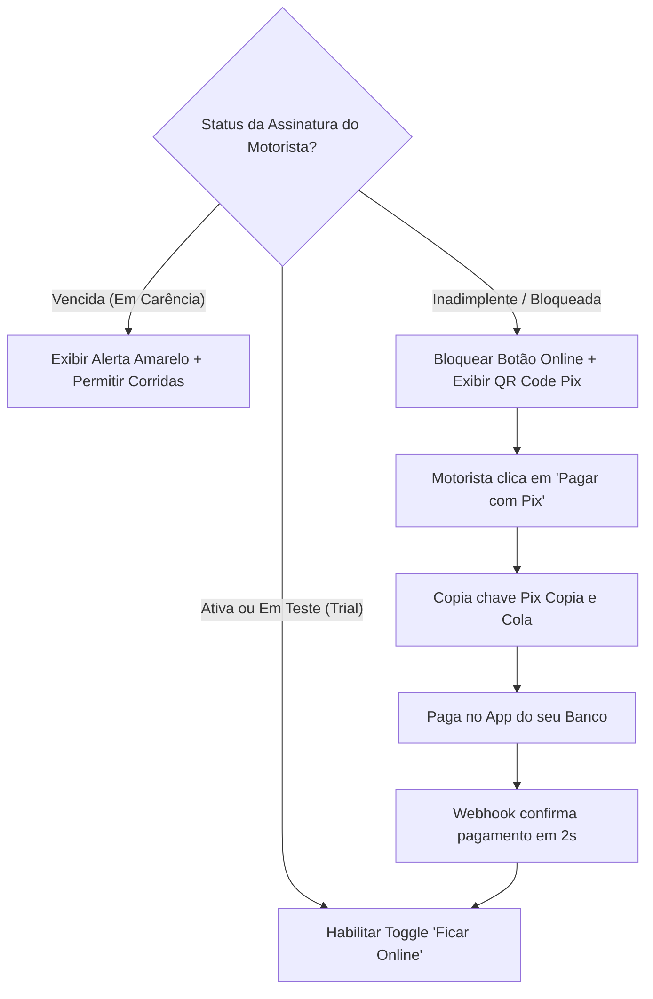

# 09. Módulos Mobile: Aplicativo do Passageiro e do Motorista (Enterprise V6.0)

---

## 1. Visão Geral das Aplicações Mobile

As interfaces móveis do **PARTIU MOBE** foram desenvolvidas como **Progressive Web Apps (PWA) de Nova Geração** e preparadas para empacotamento nativo Android/iOS via React Native (`@rnmapbox/maps`), combinando a velocidade e facilidade de distribuição da web com recursos nativos de alto desempenho:

- **Geolocalização Contínua em Segundo Plano:** Rastreamento com deadband e heartbeat temporal.
- **Mapas Vetoriais Acelerados por GPU (WebGL / Metal):** Estilo monocromático ultra-minimalista, edifícios 3D e frota volumétrica com billboarding.
- **Notificações Push & Áudio de Vigília:** Ringing de 15 segundos persistente para motoristas mesmo com a tela bloqueada.
- **Offline Protocol:** Cache inteligente de rotas e bilhetes eletrônicos.

```mermaid
graph TD
    subgraph AppPassageiro ["🙋 App do Passageiro (/app/index)"]
        P1["1. Busca de Destino & Geocoding"]
        P2["2. Seleção de Categoria (Carro / Moto / Flash / Van)"]
        P3["3. Mapa 3D & Rastreamento em Tempo Real (Pulsing Dot)"]
        P4["4. En Route Experience (Chat & SOS 190)"]
        P5["5. Pagamento Direto ao Motorista (100% Repasse Líquido)"]
        P1 --> P2 --> P3 --> P4 --> P5
    end

    subgraph AppMotorista ["🚗 App do Motorista (/app/motorista)"]
        M1["1. Cadastro Documental & Onboarding"]
        M2["2. Contratação de Plano SaaS (Pix Instantâneo)"]
        M3["3. Toggle 'Ficar Online' (Trava de Vigência)"]
        M4["4. Alerta de Oferta (Ringing 15s com Valor Líquido)"]
        M5["5. Navegação Assistida & Deadband de GPS"]
        M6["6. Painel de Ganhos Sem Descontos (0% Take Rate)"]
        M1 --> M2 --> M3 --> M4 --> M5 --> M6
    end
```

---

## 2. Experiência e Jornada do Passageiro

### A. Solicitação e Estimativa Transparente

1. **Busca Preditiva de Endereços:**  
   Integração com Geocoding otimizado com cache local de destinos frequentes (Casa, Trabalho, Aeroporto).
2. **Seleção de Categorias de Transporte:**
   - **PARTIU Pop / Econômico:** Veículos 4 portas para deslocamentos diários.
   - **PARTIU Conforto / Premium:** Veículos sedãs com ar-condicionado obrigatório.
   - **PARTIU Moto:** Viagens rápidas e econômicas individuais.
   - **PARTIU Encomendas (Flash):** Envio com **duplo PIN de segurança** (PIN de coleta e PIN de entrega).
   - **PARTIU Vans (Transporte Complementar):** Linhas fixas com bilhete offline assinado digitalmente com Ed25519.
3. **Cálculo de Preço Sem Surpresas:**  
   O passageiro visualiza o valor final antes de confirmar a corrida, calculado com base na rota viária e tabela local da praça.

### B. Motor Cartográfico 3D (Padrão Uber/99)

- **Base Map Monocromático:** `mapbox://styles/mapbox/light-v11` com supressão ativa de estabelecimentos comerciais (`poi-label`) para foco absoluto na via.
- **Polyline de Alto Contraste:** Rota traçada em preto profundo (`#1A1A1A`) com largura de 4.8px envolta por borda branca de casing (`#FFFFFF`) de 7.5px.
- **Pulsing User Dot:** Marcador do passageiro com pulso contínuo de escala (1.0x a 2.8x) em ciclo de 1800ms.
- **Frota 3D com Billboarding 2.5D:** Ícones volumétricos de carros SUV brancos e motos com piloto renderizados via GPU em Base64 Data URI, com orientação angular precisa (`iconRotate`) e compensação de inclinação de câmera a 60° (`iconPitchAlignment: 'viewport'`).

### C. En Route Experience & Segurança

- **Smart Camera Padding:** Ajuste automático de enquadramento da câmera com folga inferior de 320px para visualização desobstruída acima do Bottom Sheet.
- **Tolerância de Cancelamento:** Cancelamento sem cobrança de taxa durante os primeiros 2 minutos após o aceite do motorista.
- **Chat em Tempo Real:** Conversas protegidas com máscara de dados sensíveis (PII) e respostas rápidas em um toque.
- **Botão de Emergência SOS 190:** Compartilhamento imediato de localização geográfica com a central de monitoramento.

### D. Pagamento Direto e Conclusão

- **Formas de Pagamento:**
  - _Pix Direto ao Motorista:_ O aplicativo gera QR Code Pix com chave do condutor na tela de desembarque.
  - _Dinheiro Físico:_ Pagamento em espécie diretamente ao condutor.
  - _Cartão de Débito/Crédito:_ Pagamento na maquininha do condutor no veículo.
- **Taxa da Plataforma:** 0% de comissão retida.

---

## 3. Experiência e Jornada do Motorista Parceiro

### A. Validação Documental e Onboarding

- Upload de CNH com observação EAR, CRLV do veículo e comprovante de endereço.
- Análise de segurança centralizada com notificação de aprovação.

---

### B. Gestão da Assinatura SaaS e Regularização no App

O motorista conta com uma central financeira integrada:

- **Transparência de Valores:** Os planos (Diário, Semanal ou Mensal) destacam o repasse de 100% de todas as corridas.
- **Autonomia Total:** Sem contratos de fidelidade compulsória; o condutor pode ativar uma diária apenas nos dias em que decidir rodar.

---

### C. O Ciclo da Corrida para o Condutor

1. **Recepção da Oferta (Ringing & Alerta Sonoro):**
   - Ao receber uma chamada próxima, o app emite alerta sonoro e vibratório contínuo.
   - O card de oferta exibe: **Valor Líquido da Corrida**, **Distância até o Passageiro**, **Endereço de Embarque** e **Destino Final**.
   - Barra de contagem regressiva de 15 segundos para aceite atômico.
2. **Telemetria com Deadband Geográfico:**
   - Supressão de 34% de escritas redundantes de GPS quando o veículo está parado em semáforos, economizando bateria e dados móveis do condutor.
3. **Navegação Assistida:**
   - Botão de abertura em um toque no **Google Maps** ou **Waze** com as coordenadas exatas da rota.
4. **Painel de Ganhos Sem Descontos:**
   - Extrato do condutor exibe faturamento integral recebido sem qualquer linha de retenção ou comissão da plataforma.
