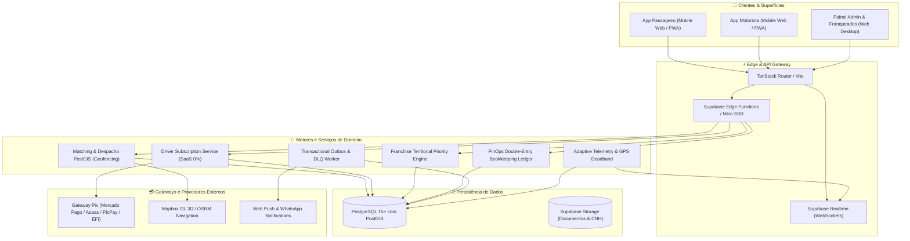

# 📚 PARTIU MOBE — Documentação Técnica & Arquitetural do Ecossistema

> **Versão:** 6.0 Enterprise SaaS  
> **Status:** Produção Homologada & 100% Testada (411/411 Testes Automatizados Aprovados em 39 Suítes)  
> **Modelo de Negócio:** SaaS Puro com Taxa Zero por Corrida (0% Take Rate)

---

## 📌 Sumário Executivo

O **PARTIU MOBE** é uma plataforma corporativa e resiliente de mobilidade urbana sob demanda e logística fracionada, desenvolvida com tecnologia de ponta para atender cidades médias, grandes polos urbanos e operações franqueadas (*White-Label*).

Diferente das plataformas legadas de transporte por aplicativo (como Uber e 99, que retêm entre 20% e 40% do valor bruto de cada corrida), o ecossistema PARTIU opera sob o modelo **SaaS Puro com Taxa Zero (0% Take Rate)**:
1. **O motorista parceiro retém 100% do valor bruto das viagens**, recebendo os pagamentos diretamente dos passageiros de forma líquida e imediata (D+0).
2. **A plataforma e os operadores locais monetizam exclusivamente via assinaturas periódicas** (Planos Diário 24h, Semanal, Mensal Pro, Trimestral ou Anual VIP) contratadas pelos motoristas para manter o direito de receber chamados no aplicativo.
3. **O motor de despacho e matching geográfico (PostGIS)** condiciona estritamente a distribuição de viagens aos condutores com documentos aprovados e assinatura ativa no sistema.
4. **Governança Territorial de Franquias:** A Matriz Nacional opera como cobertura soberana de todo o Brasil, enquanto Franquias Regionais operam com barreiras anti-invasão de perímetro e direito de expansão de cidades vizinhas gerenciado pelo Super Admin.

---

## 📂 Mapa da Documentação

A documentação está modularizada nos seguintes guias técnicos detalhados:

| Arquivo | Título | Conteúdo Principal |
| :--- | :--- | :--- |
| [01_VISAO_GERAL_E_ECOSSISTEMA.md](./01_VISAO_GERAL_E_ECOSSISTEMA.md) | **Visão Geral e Ecossistema** | Proposta de valor, diferenciais competitivos, atores da plataforma, governança de praças, hierarquia de franquias e jornadas do usuário. |
| [02_STACK_TECNOLOGICA_E_INFRAESTRUTURA.md](./02_STACK_TECNOLOGICA_E_INFRAESTRUTURA.md) | **Stack Tecnológica e Infraestrutura** | Arquitetura de frontend (React 19, Vite, TanStack Start com SSR Nitro, Tailwind v4), backend Supabase / Node.js, PostGIS, Realtime e segurança. |
| [03_DESIGN_SYSTEM_E_IDENTIDADE_VISUAL.md](./03_DESIGN_SYSTEM_E_IDENTIDADE_VISUAL.md) | **Design System e Identidade Visual** | Tokens visuais, paleta de cores (Brand, Neutros, Semânticos), tipografia, grid de 8pt, elevações M3 e regras de acessibilidade WCAG. |
| [04_MODELO_DE_NEGOCIO_E_MONETIZACAO.md](./04_MODELO_DE_NEGOCIO_E_MONETIZACAO.md) | **Modelo de Negócio e Monetização** | Regra North Star (0% take rate), catálogo de planos, ciclo de vida, trial configurável (3, 7, 30 dias), gateway Pix automático, trava de matching e split contábil. |
| [05_ARQUITETURA_DE_SOFTWARE_E_ENGENHARIA.md](./05_ARQUITETURA_DE_SOFTWARE_E_ENGENHARIA.md) | **Arquitetura de Software e Engenharia** | FSMs de domínio, Ledger contábil de dupla entrada, Transactional Outbox, Idempotência, Telemetria com Deadband e Geofencing de Franquias. |
| [06_BANCO_DE_DADOS_E_SCHEMAS.md](./06_BANCO_DE_DADOS_E_SCHEMAS.md) | **Banco de Dados e Schemas PostgreSQL** | DDL das tabelas principais, índices geoespaciais PostGIS, políticas de Row Level Security (RLS), tabelas de franquias e triggers defensivas. |
| [07_CONTRATOS_DE_API_E_INTEGRACOES.md](./07_CONTRATOS_DE_API_E_INTEGRACOES.md) | **Contratos de API e Integrações** | Endpoints REST, Edge Functions (verify-and-create-ride com fallback geodésico), RPCs PostgreSQL, canais Supabase Realtime e Webhooks Pix. |
| [08_MODULO_PAINEL_ADMINISTRATIVO.md](./08_MODULO_PAINEL_ADMINISTRATIVO.md) | **Painel Administrativo Web** | Telas executivas, Dashboard SaaS (MRR/ARR/Churn), Gestão de Franquias e Territórios, Central de Monetização, Radar de Despacho e Modo Avançado. |
| [09_MODULOS_MOBILE_PASSAGEIRO_E_MOTORISTA.md](./09_MODULOS_MOBILE_PASSAGEIRO_E_MOTORISTA.md) | **Módulos Mobile (Passageiro e Motorista)** | Fluxo completo do app do passageiro (chamada, rastreio 3D, pagamento) e do motorista (assinatura Pix, toggle online, aceite atômico e navegação). |
| [10_GUIA_DE_DESENVOLVIMENTO_DEPLOY_E_OPERACAO.md](./10_GUIA_DE_DESENVOLVIMENTO_DEPLOY_E_OPERACAO.md) | **Desenvolvimento, Testes, Deploy e Operação** | Execução local, suíte de 411 testes em 39 suítes, benchmarks de despacho/carga, linters de governança, deploy Nitro SSR e sanitização de credenciais. |

---

## 🏗️ Visão Geral da Arquitetura de Alto Nível

---

## 🎯 Pilares Estruturais do Ecossistema

1. **Taxa Zero Inegociável (0% Take Rate):**  
   O motorista é o verdadeiro protagonista do negócio. Cada corrida concluída rende 100% líquido para o bolso de quem dirigiu. A plataforma nunca cobra comissão percentual ou retém créditos fracionados por viagem.
2. **Receita Recorrente Previsível (SaaS):**  
   A saúde financeira da empresa baseia-se em MRR (Monthly Recurring Revenue), com planos de assinatura flexíveis e automação de cobrança via Pix com liberação instantânea em segundos.
3. **Engenharia Resiliente e Confiabilidade Extrema:**  
   Arquitetura inspirada em padrões corporativos *ByteByteGo*, possuindo 411 testes automatizados em 39 suítes corporativas cobrindo condições adversas, race conditions de despacho, ledger de dupla entrada imutável e operação offline segura.
4. **Governança Multi-Tenant e Prioridade Territorial:**  
   Suporte nativo à hierarquia de franquias (Matriz Nacional irrestrita e Franquias Regionais com barreiras anti-invasão e direito de expansão de cidades vizinhas gerenciado pelo Super Admin).
5. **Segurança Zero-Trust & Sanitização Contínua:**  
   Auditoria estrita contra vazamento de credenciais em código-fonte, RLS mandatório em todas as tabelas do PostgreSQL e integridade validada via assinaturas Ed25519 e HMAC-SHA256.
